# Лабораторная работа 1 "У нас есть докер дома"
## Подготовка виртуальной машины и сервиса
### Виртуалка
Лаба выполнялась на маке поэтому была поднята ubuntu 24.04 через мультипасс со следующими параметрами:
``` bash
multipass launch 24.04 --name lab1 --cpus 2 --memory 4G --disk 20G
```

### Сервис
Сервис был навайбкожен клодиком на Go:
- Только стандартная библиотека
- Бинарник статический
- `/eat?mb=N` не просто выделяет память, а записывает байт в каждую страницу. `make` даёт только виртуальные адреса, физическую страницу ядро подкладывает при первой записи (page fault), и только такие страницы попадают в RSS и в `memory.current` cgroup. Без записи лимит памяти и OOM в части 3 было бы не на чем показать. Выделенные куски держатся в глобальной переменной, поэтому GC их не освобождает.

```P.S. Максим: я ради интереса внутрь залез - я бы такого не смог написать... Мне религия не позволяет для счетчика заблокировать целый поток и сделать ручку, реализующую утечку памяти```

Клодик также добавил помимо ручек `/eat?mb=N`, `/burn` и `/health` ещё и ручку `/whoami` (печатает pid, ppid, uid, gid, hostname), сказал что она нам будет нужна в части 2 чтобы показать "изнутри PID 1 и root, снаружи обычный процесс" - мы ему верим он умный

## Часть 1 - Запуск напрямую
Бинарник был успешно скомпилирован и загружен (со второго раза) на ВМ
``` bash
# Компиляция
cd lab-1/api
CGO_ENABLED=0 GOOS=linux GOARCH=arm64 go build -o bin/api .
```

- `CGO_ENABLED=0` позволяет сделать бинарник статическим и не тащить за собой libc
- `GOOS=linux` и `GOARCH=arm64` собирают бинарник под нужную систему и архитектуру CPU

``` bash
# Загрузка на ВМ
multipass transfer bin/api lab1:api
```

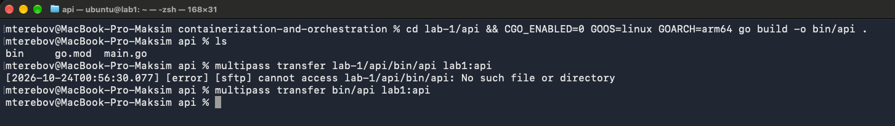

Бинарнику были изменены права и он был запущен из соседнего терминала проверили `/health` и `/whoami`
```bash
chmod +x ~/api && ~/api
```

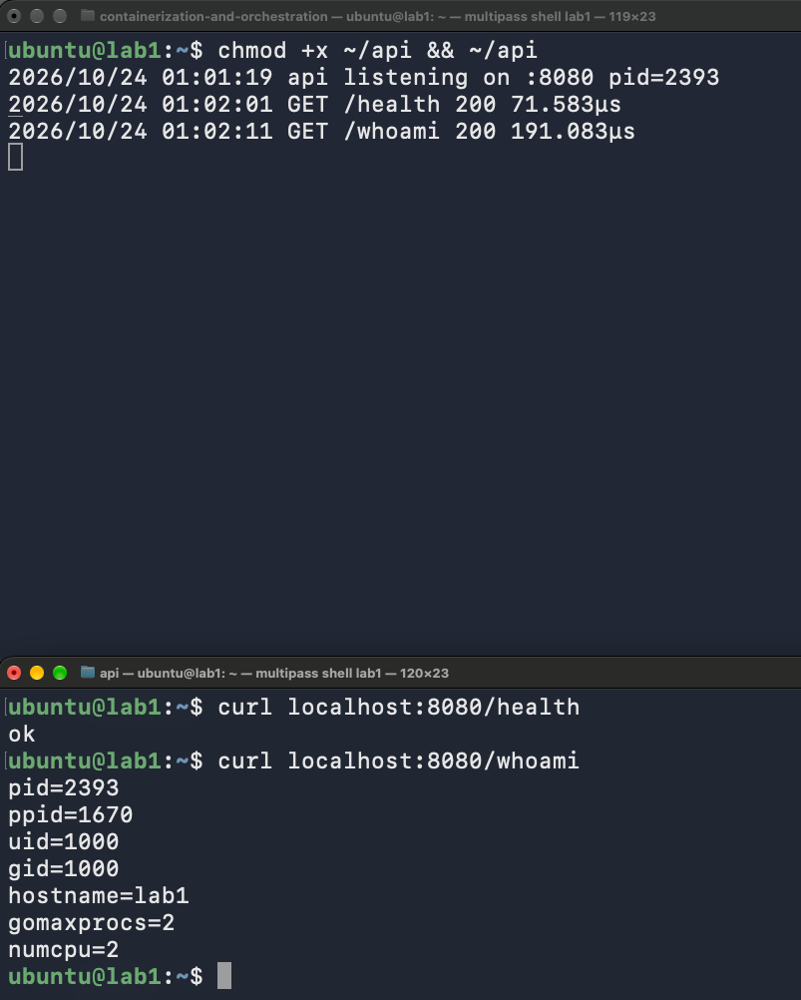

`/health` так же был проверен из браузера

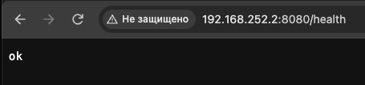

с помощью `pgrep -a api` был проверен PID - он совпал с тем, что отдала ручка `/whoami` как и должно быть


Так же был сделан снимок состояния ДО чтобы смотреть как оно меняется в процессе лабораторной

Что процесс видит:

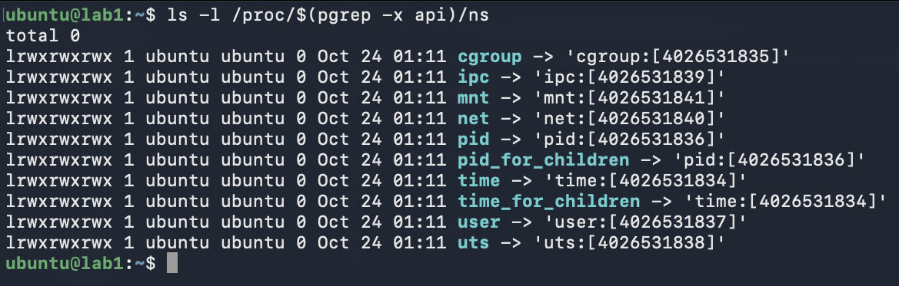

Сколько ему можно взять:

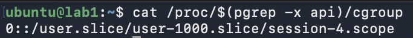

Что ему можно:

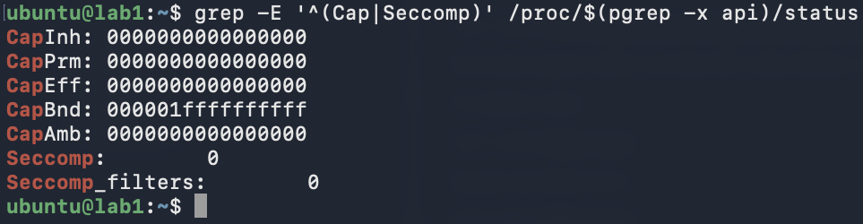

Для сравнения: namespaces init (PID 1) и фактические лимиты cgroup, в котором живёт процесс


## Часть 2 - namespaces
Сначала с помощью

``` bash
pkill -x api
```

был остановлен api иначе curl бы попадал в старый экземпляр

После была произведена попытка ~~поднять молот Тора~~ с помощью команды `unshare -Ur id -u` создать namespace и прописаться там как рутовый пользователь, namespace создался, а дальше, как я понял, прописаться туда рутом нам не позволила какая-то невероятная надстройка AppArmor'а, появившаяся в ubuntu 23.10, которая блокирует подобные действия

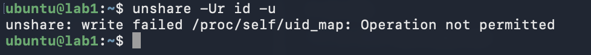

~~Один был убит~~ Проклятие сняли отключив эту надстройку AppArmor'а командой `sudo sysctl -w kernel.apparmor_restrict_unprivileged_userns=0 && unshare -Ur id -u`

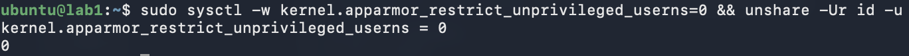

Сначала нарочно запустили без --mount-proc. pid namespace уже новый, echo $$ внутри даёт 8, но ps читает /proc, а там смонтирован хостовый procfs, привязанный к pid namespace хоста: видны все процессы системы с хостовыми номерами, readlink /proc/self даёт 2719. Вывод: pid namespace изолирует нумерацию процессов, а что покажет ps, определяет mount namespace, то есть какой /proc смонтирован. Заодно виден user namespace: процессы настоящего root показаны как nobody, потому что uid 0 хоста внутрь не отображён, а unshare, api и bash показаны как root, потому что uid 1000 отображён в 0.

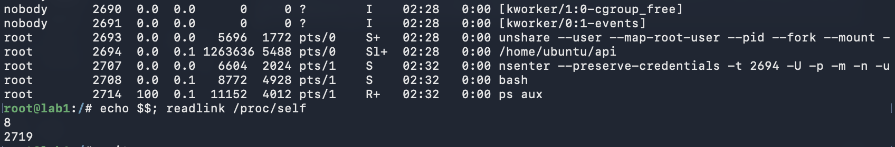

### Запуск в namespaces

```bash
unshare --user --map-root-user --pid --fork --mount --mount-proc --net --uts --ipc ~/api
```

- `--user --map-root-user` стоит первым и без sudo: ядро создаёт user namespace и даёт процессу в нём полный набор capabilities, их хватает, чтобы создать остальные пять. uid 1000 снаружи отображается в 0 внутри.
- `--pid --fork`: `unshare(CLONE_NEWPID)` не переносит вызывающий процесс, новый pid namespace получают только его дети. Поэтому unshare форкается, и PID 1 становится ребёнок, который делает exec в api.
- `--mount --mount-proc`: свежий procfs для нового pid namespace монтируется поверх `/proc` в собственной таблице монтирования, хостовый `/proc` не трогается.
- `--net`, `--uts`, `--ipc`: свой сетевой стек, свой hostname, свои объекты IPC.

Вход внутрь, тоже без sudo, потому что владелец user namespace (uid 1000) имеет в нём все capabilities:

```bash
nsenter --preserve-credentials -t $(pgrep -x api) -U -p -m -n -u -i -- bash
```

Без `--preserve-credentials` nsenter падал на `setgroups failed`: `--map-root-user` записал `deny` в `/proc/PID/setgroups` (ядро требует этого до записи `gid_map` непривилегированным процессом), и `setgroups()`, который nsenter вызывает по умолчанию, в этом namespace невозможен.

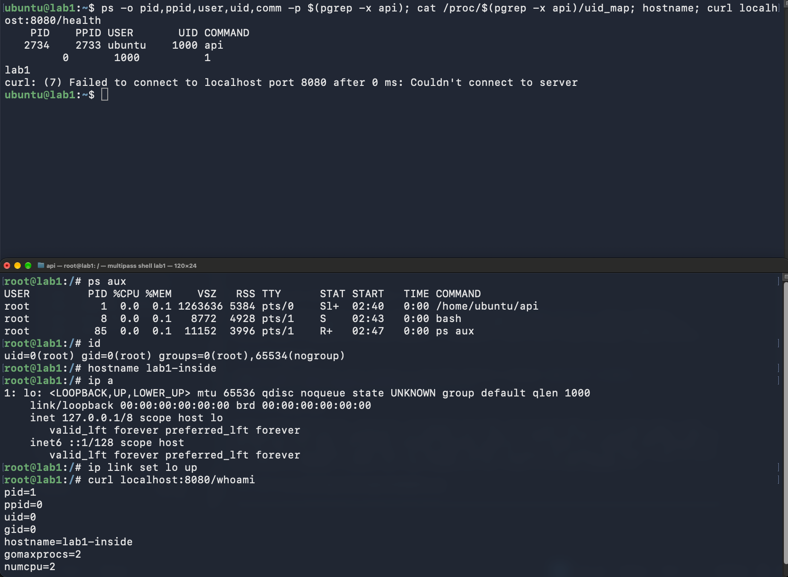

Внутри: `ps aux` показывает три процесса, api это PID 1. `id` даёт uid 0. `ip a` показывает только lo, и тот лежит, пока не поднять руками. После `hostname lab1-inside` и `ip link set lo up` ручка `/whoami` отвечает `pid=1 uid=0 hostname=lab1-inside`.

Снаружи тот же процесс: PID 2734, user ubuntu, uid 1000. `/proc/2734/uid_map` содержит `0 1000 1`, то есть ровно один uid отображён. Hostname хоста по-прежнему lab1. `curl localhost:8080` с хоста не проходит: порт 8080 открыт в другом сетевом стеке.

`ppid=0` у api внутри: родитель, процесс unshare (PID 2733 на хосте), остался в хостовом pid namespace и в новом не имеет номера. Для процессов, которых в namespace нет, ядро возвращает PID 0. Поэтому изнутри не виден даже собственный родитель.

### Что изолировал каждый namespace

| namespace | что изолировал | чем проверили |
|---|---|---|
| pid | нумерацию процессов: api внутри PID 1, снаружи 2734; видны только свои процессы | `ps aux` внутри, `ps -p` снаружи |
| user | uid/gid: 0 внутри это 1000 снаружи; capabilities «root» действуют только внутри | `id`, `/proc/PID/uid_map`, процессы хостового root видны как nobody |
| mnt | таблицу монтирования: свой `/proc`, хостовый не тронут | без `--mount-proc` ps показывал хостовые процессы |
| net | сетевой стек: только lo, порт 8080 с хоста недоступен | `ip a` внутри, curl с хоста |
| uts | hostname: lab1-inside внутри, lab1 снаружи | `hostname` внутри и снаружи |
| ipc | объекты System V IPC и POSIX-очереди | отдельно не проверяли |

Что осталось общим с хостом: корневая файловая система (внутри тот же `/home/ubuntu/api` и тот же `curl`: mount namespace копирует таблицу хоста, а не даёт новый корень, это закроет образ в части 6), ядро, cgroup (не трогали, это часть 3) и время.

## Часть 3 - cgroups
### Шаг 1 - cgroup и переезд в него

Cgroup в v2 это просто каталог в `/sys/fs/cgroup`: сделали `mkdir`, ядро само насыпало внутрь файлы-ручки. Какие контроллеры достанутся новой группе, решает `cgroup.subtree_control` родителя, у корня это `cpu memory pids`, ровно то, что нам нужно.

```bash
sudo mkdir /sys/fs/cgroup/mydocker && cat /sys/fs/cgroup/mydocker/cgroup.controllers
echo $(pgrep -x api) | sudo tee /sys/fs/cgroup/mydocker/cgroup.procs
echo $(pgrep -P $(pgrep -x nsenter)) | sudo tee /sys/fs/cgroup/mydocker/cgroup.procs
```

Переезд это запись PID в `cgroup.procs`, переезжают сразу все потоки процесса. Перенесли и api, и наш внутренний шелл из nsenter: дети наследуют cgroup при fork, так что всё, что мы из этого шелла запустим (curl, stress-ng), окажется под теми же лимитами. Переносили с хоста по хостовому PID, хотя api сидит в чужих namespaces: cgroups и namespaces друг о друге не знают, это две независимые оси, одна про «что процесс видит», другая про «сколько ему можно».

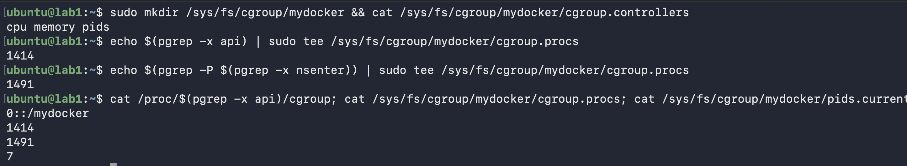

`/proc/PID/cgroup` сменился с `session-4.scope` (снимок «до» из части 1) на `/mydocker`. В `cgroup.procs` два PID, а `pids.current` показывает 7: контроллер pids считает не процессы, а задачи ядра, то есть потоки. Go-рантайм в api держит несколько потоков (GC, sysmon, сетевой поллер) плюс один поток bash. Поэтому `pids.max` надо брать с запасом над этим числом, а не «2 процесса», иначе api упрётся в лимит на первом же новом потоке.

### Шаг 2 - CPU: полкора

```bash
echo "50000 100000" | sudo tee /sys/fs/cgroup/mydocker/cpu.max
```

Два числа это квота и период в микросекундах: 50 мс работы на каждые 100 мс, то есть половина ядра. Внутри дёрнули `/burn`, он крутит одну горутину на 100% ядра, api честно хотел целое ядро, а выдали половину.

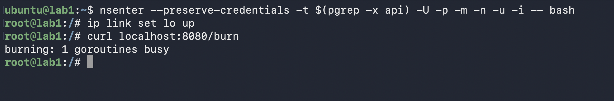

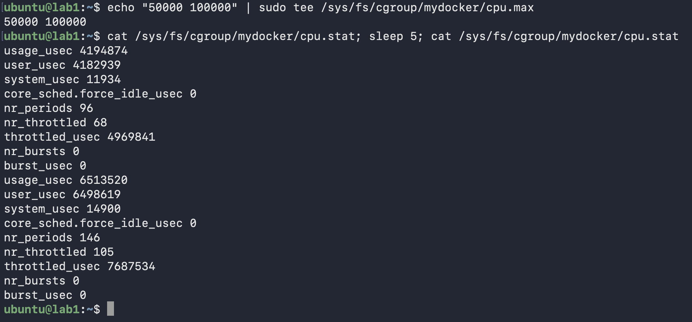

Два снимка `cpu.stat` с разницей в 5 секунд: `nr_periods` 96 → 146 (50 периодов по 100 мс = 5 секунд), `nr_throttled` 68 → 105, `throttled_usec` 4.97 с → 7.69 с, `usage_usec` 4.19 с → 6.51 с. То есть за 5 секунд api получил 2.3 секунды процессора (46%, упёрлось в квоту 50%) и 37 из 50 периодов просидел в throttle: квоту выбирает за первые 50 мс периода, остаток ждёт. Процесс при этом не умирает и никаких ошибок не видит, он просто тормозит. В Kubernetes это `limits.cpu`: kubelet пишет то же самое в `cpu.max`, а throttling снаружи виден только по метрике `container_cpu_cfs_throttled_periods_total` и по выросшей латентности.

### Шаг 3 - pids.max против fork-бомбы

```bash
echo 20 | sudo tee /sys/fs/cgroup/mydocker/pids.max
```

20 с запасом над теми 7 потоками, что уже сидят в группе. Fork-бомбу пускали изнутри, из нашего шелла в nsenter, он в том же cgroup, так что всё, что он породит, считается в тот же `pids.current`. Первая попытка упала на `temp-path '.' must be readable and writeable`: после nsenter мы стоим в `/`, а он принадлежит настоящему root, для нашего «root внутри» это чужой `nobody`, писать нельзя. Ещё раз видно, что корень ФС общий с хостом. Ушли в `/tmp`.

```bash
cd /tmp && stress-ng --fork 8 --timeout 10s
```

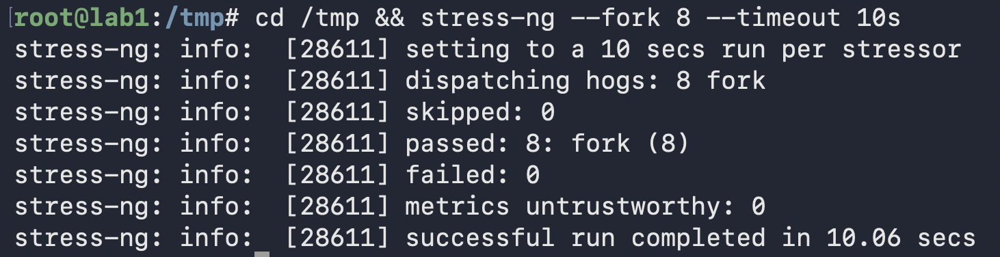

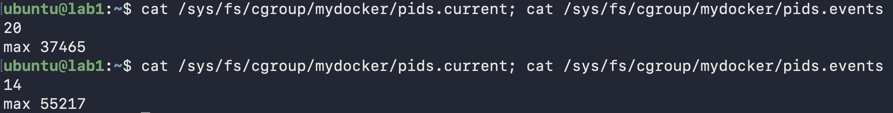

Сам stress-ng отчитался `passed: 8, failed: 0`: отказ `fork()` с `EAGAIN` он считает штатной ситуацией и молча пробует снова, поэтому его резюме выглядит как успех. Правда в cgroup: `pids.current` во время прогона стоял ровно на потолке 20 (7 потоков api и шелла, stress-ng с восемью воркерами, и всё, на детей места уже почти нет), а `pids.events` показывал `max 37465` и под конец `max 55217`: столько раз за 10 секунд ядро отказало в `fork`. Бомба не размножилась, api при этом жив и отвечает. В Docker это `--pids-limit`, в Kubernetes `podPidsLimit` у kubelet, оба пишут в тот же `pids.max`.

### Шаг 4 - память и OOM

```bash
echo 64M | sudo tee /sys/fs/cgroup/mydocker/memory.max; echo 0 | sudo tee /sys/fs/cgroup/mydocker/memory.swap.max
```

`memory.swap.max=0` нужен, потому что иначе при упоре в лимит ядро сначала вытесняет страницы в своп, а не убивает. В нашей VM свопа нет, но скрипт из части 5 на это полагаться не должен; Kubernetes по умолчанию делает то же самое. Сначала съели 30 МБ:

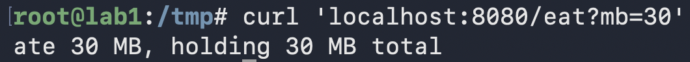

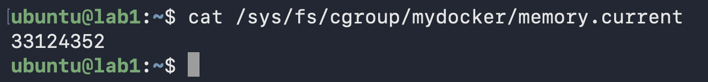

`memory.current` = 33124352 байт, это 31.6 МиБ: 30 МиБ от `/eat` плюс немного нового. Память, которую api занял до переезда в cgroup, осталась на счету старой группы: списание идёт на ту группу, где страница была выделена, при переезде процесса оно не переезжает. Потом попросили ещё 50:

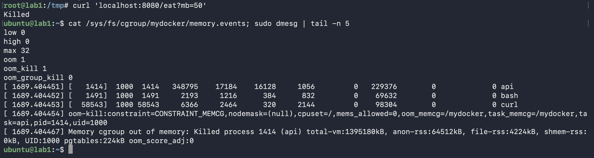

Curl получил `Killed`, и это убили не curl. В `memory.events`: `max 32` (32 раза группа упёрлась в лимит, и ядро пыталось что-то вытеснить, а вытеснять без свопа нечего), `oom 1`, `oom_kill 1`. В dmesg ядро перечислило задачи группы (api, bash, curl), выбрало самую жирную и написало `Memory cgroup out of memory: Killed process 1414 (api) anon-rss:64512kB`: 63 МиБ anon как раз и есть потолок 64M. Вместе с api умер и наш внутренний шелл: api это PID 1 своего pid namespace, а когда init namespace погибает, ядро добивает всех остальных в нём. Это и есть `OOMKilled` в Kubernetes: `limits.memory` превращается в тот же `memory.max`, kubelet видит код выхода 137 (SIGKILL), перезапускает контейнер, а если это повторяется, получается `CrashLoopBackOff`.

### Итог части 3

Память бьёт убийством, CPU бьёт задержкой, pids просто отказывает в `fork`. Все три лимита это файлы в одном каталоге cgroup, Docker и kubelet пишут в них ровно то же самое, что мы руками.

## Часть 4 - привилегии
### Шаг 1 - что умеет root внутри user namespace

Api у нас живёт в user namespace как «root», и прежде чем что-то резать, стоило понять, что этот root вообще может. Свежий namespace со своим hostname:

```bash
unshare -Ur -u bash
```

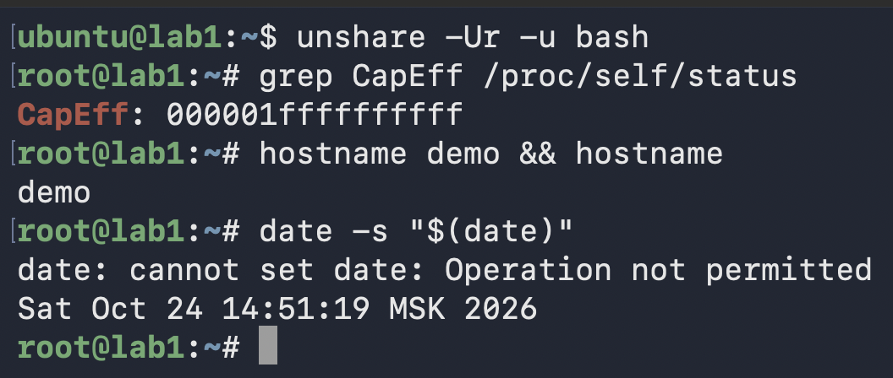

`CapEff` полный, все 41 бит, `hostname demo` проходит, а `date -s` отбивается с `Operation not permitted`, хотя набор тот же. Разница в том, где ядро проверяет capability. Для `sethostname` нужен `CAP_SYS_ADMIN` в том user namespace, которому принадлежит uts namespace, а он наш. Для `clock_settime` нужен `CAP_SYS_TIME` в корневом user namespace хоста: часы у ядра одни на всех, их не изолировать. Так что user namespace сам по себе уже отрезает всё, что не делится по namespace (время, модули ядра, reboot), а root внутри это root только над своими namespace.

### Шаг 2 - отрезать всё

```bash
setpriv --bounding-set=-all --inh-caps=-all bash
```

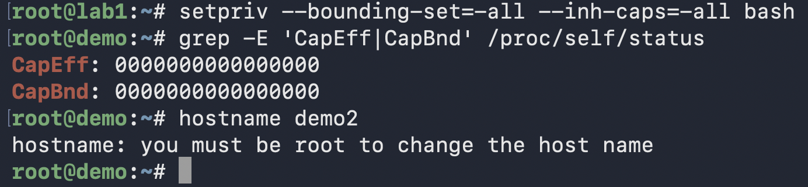

`CapEff` и `CapBnd` нули, `hostname demo2` уже не проходит (hostname пишет «you must be root», хотя мы всё ещё uid 0, он просто так переводит EPERM). Bounding set это потолок, и он только опускается: системного вызова «поднять обратно» нет. Capabilities попадают в процесс двумя путями, через наследование при exec и через ambient-набор, и оба маскируются bounding set. Правило «root при exec получает всё» проходит через ту же маску. Поэтому ноль это навсегда, для процесса и всех его детей: ~~прыгнул в колодец без рук и ног~~.

### Шаг 3 - api без единой capability

Api они не нужны: порт 8080 выше 1024, файлы свои, ничего привилегированного он не делает. Поэтому запускаем его в тех же namespaces, но через setpriv:

```bash
unshare --user --map-root-user --pid --fork --mount --mount-proc --net --uts --ipc setpriv --bounding-set=-all --inh-caps=-all ~/api
```

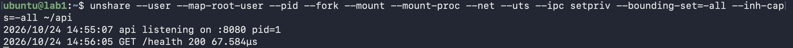

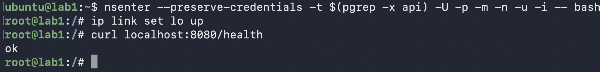

`ip link set lo up` изнутри проходит, потому что шелл из nsenter получает свои capabilities при входе в user namespace, ему мы ничего не резали. Api при этом работает как ни в чём не бывало. Снаружи:

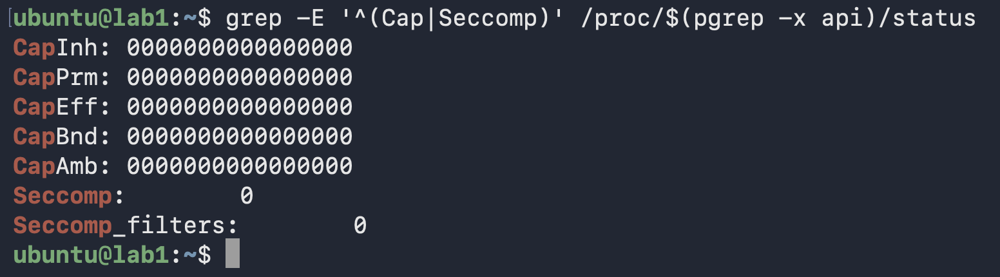

Все пять наборов по нулям, это пара к снимку «до» из части 1, где `CapBnd` был полный. `Seccomp: 0` пока, это следующий шаг.

### Шаг 4 - seccomp

Seccomp-профиль это список системных вызовов и что с ними делать: ядро сверяет с ним каждый syscall процесса и либо пропускает, либо возвращает ошибку, либо убивает. Capabilities отвечали «что процессу можно», seccomp отвечает «какими вызовами ядра он вообще может пользоваться». Профиль [seccomp.json](seccomp.json) в формате Docker: всё разрешено, кроме восьми вызовов, на них EPERM. `mkdir`/`mkdirat` там ради наглядной демонстрации, остальные это то, что api не нужно и что закрывает опасное: смена hostname, монтирование, отладка чужих процессов (`ptrace`), перезагрузка, загрузка модулей ядра. У Docker по умолчанию наоборот, белый список из ~350 вызовов, но для лабы хватило чёрного.

Докера у нас нет, навесить профиль некому, поэтому навешивает маленький загрузчик [seccomp_exec.py](seccomp_exec.py): читает JSON, собирает фильтр через libseccomp, грузит его в ядро и делает `exec` в команду. Фильтр наследуется всеми детьми, и снять его процесс не может, как и вернуть capabilities. Сначала проверили на шелле:

```bash
python3 ~/seccomp_exec.py ~/seccomp.json -- bash
```

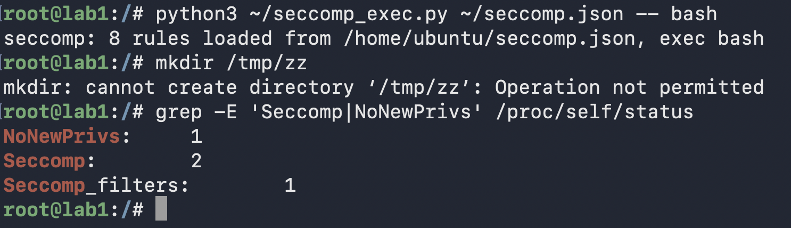

`mkdir /tmp/zz` отбит с `Operation not permitted`, хотя у этого шелла есть все capabilities, а в `/tmp` писать можно кому угодно: это не права, это фильтр. В статусе `Seccomp: 2` (режим filter, в части 1 здесь был 0), `Seccomp_filters: 1` и `NoNewPrivs: 1`: libseccomp ставит этот флаг, чтобы фильтр можно было грузить без capabilities, а заодно он запрещает получать привилегии через setuid-бинарники.

Потом api, полная цепочка «namespaces, seccomp, capabilities, api»:

```bash
unshare --user --map-root-user --pid --fork --mount --mount-proc --net --uts --ipc python3 ~/seccomp_exec.py ~/seccomp.json -- setpriv --bounding-set=-all --inh-caps=-all ~/api
```

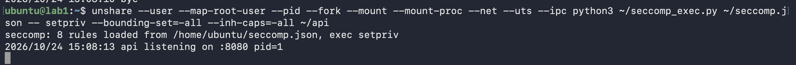

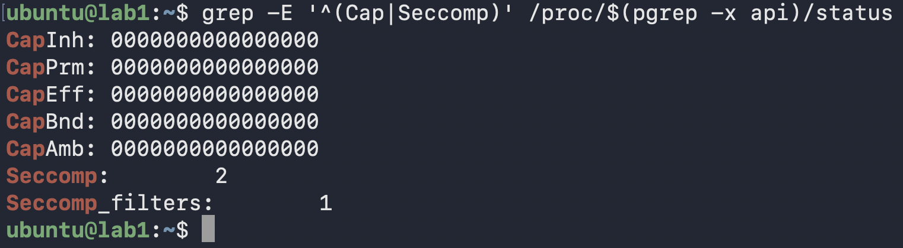

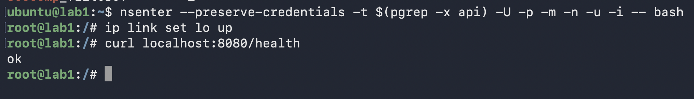

Api работает: ему хватает `read`, `write`, `accept` и прочего обычного, ничего из чёрного списка он не зовёт.

### Итог части 4

Что закрывает каждый механизм:

- **user namespace**: root внутри это root только над своими namespace. Всё, что не делится по namespace (время, модули ядра, reboot), отрезано ещё до capabilities.
- **capabilities**: привилегированные действия внутри namespace (сменить hostname, поднять интерфейс, монтировать). Bounding set опущен в ноль, обратно не поднять.
- **seccomp**: сами системные вызовы. Даже если бы capabilities вернулись, `mount` или `ptrace` упёрлись бы в фильтр. Это второй, независимый забор.

Docker делает ровно то же: `--cap-drop`/`--cap-add` правят bounding set, `--security-opt seccomp=profile.json` грузит такой же JSON через libseccomp, по умолчанию с белым списком.
