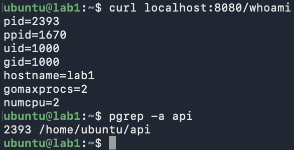
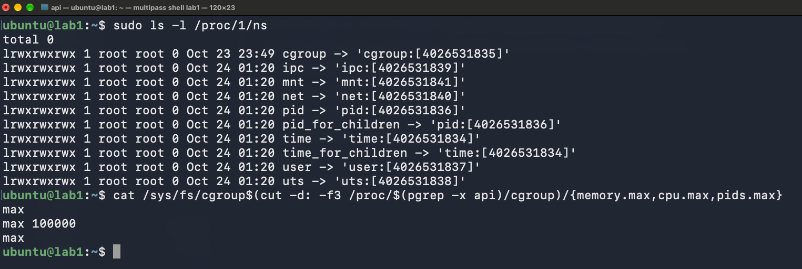

# Лабораторная работа 1 "У нас есть докер дома"
## Подготовка виртуальной машины и сервиса
### Виртуалка
Лаба выполнялась на маке поэтому была поднята ubuntu 24.04 через мультипасс со следующими параметрами:
``` bash
multipass launch 24.04 --name lab1 --cpus 2 --memory 4G --disk 20G
```

### Сервис
Сервис был навайбкожен клодиком на Go:
- Только стандартная библиотека
- Бинарник статический
- `/eat?mb=N` не просто выделяет память, а записывает байт в каждую страницу. `make` даёт только виртуальные адреса, физическую страницу ядро подкладывает при первой записи (page fault), и только такие страницы попадают в RSS и в `memory.current` cgroup. Без записи лимит памяти и OOM в части 3 было бы не на чем показать. Выделенные куски держатся в глобальной переменной, поэтому GC их не освобождает.

```P.S. Максим: я ради интереса внутрь залез - я бы такого не смог написать... Мне религия не позволяет для счетчика заблокировать целый поток и сделать ручку, реализующую утечку памяти```

Клодик также добавил помимо ручек `/eat?mb=N`, `/burn` и `/health` ещё и ручку `/whoami` (печатает pid, ppid, uid, gid, hostname), сказал что она нам будет нужна в части 2 чтобы показать "изнутри PID 1 и root, снаружи обычный процесс" - мы ему верим он умный

## Часть 1 - Запуск напрямую
Бинарник был успешно скомпилирован и загружен (со второго раза) на ВМ
``` bash
# Компиляция
cd lab-1/api
CGO_ENABLED=0 GOOS=linux GOARCH=arm64 go build -o bin/api .
```

- `CGO_ENABLED=0` позволяет сделать бинарник статическим и не тащить за собой libc
- `GOOS=linux` и `GOARCH=arm64` собирают бинарник под нужную систему и архитектуру CPU

``` bash
# Загрузка на ВМ
multipass transfer bin/api lab1:api
```


Бинарнику были изменены права и он был запущен из соседнего терминала проверили `/health` и `/whoami`
```bash
chmod +x ~/api && ~/api
```


`/health` так же был проверен из браузера


с помощью `pgrep -a api` был проверен PID - он совпал с тем, что отдала ручка `/whoami` как и должно быть



Так же был сделан снимок состояния ДО чтобы смотреть как оно меняется в процессе лабораторной

Что процесс видит:


Сколько ему можно взять:


Что ему можно:


Для сравнения: namespaces init (PID 1) и фактические лимиты cgroup, в котором живёт процесс


