# Лаба 2 — Мониторинг всякого важного

## Часть 0 — свой сервис (сервис Клода)

С помощью клодик кода был сгенерирован сервис на Go, выполняющий все требования из лабы. Ручки:

- `GET /health`
- `GET /fail`
- `GET /slow`
- `GET /load`
- `GET /metrics`

Что сервис отдаёт:

**Метрики:**

- `http_requests_total{method,route,code}`;
- `http_request_errors_total{route}` — только 5xx;
- `http_request_duration_seconds{method,route,code}`;
- метрики рантайма `go_*` и процесса `process_*`.

**Логи:** JSON в stdout.

**Трейсы:** корневой span (`GET /slow` и т. п.) создаёт otelhttp, внутри — вложенные `slow-op` и `fail-op`. Отправка по OTLP/HTTP на адрес из `OTEL_EXPORTER_OTLP_ENDPOINT`.

Далее установили helm и kind на макбук (Pro M5 14", 16/512 GB).

После этого подняли кластер через kind и проверили, что с ним всё ок:

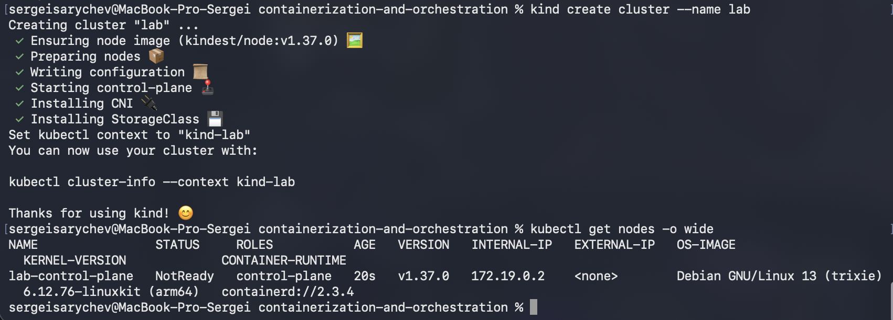

Вроде всё действительно ок (нода была NotReady, но через минуту стала Ready), но мне посоветовали обновить kubectl, так как он у меня отставал на 3 версии. Вроде и так нормик, но на всякий обновил.

После этого собрали образ и загрузили его в ноду:


Он действительно подгрузился:

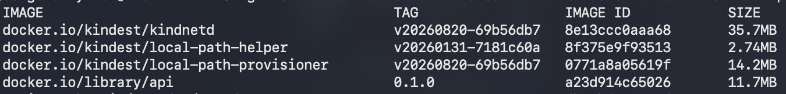

Написали манифест, в нём расписали, что делать, если под не готов или завис, и сколько ресурсов выделять. Он лежит в [k8s/api.yaml](k8s/api.yaml).

Применили манифест, перенаправили порты — и увидели, что `/health` отвечает на запросы, а значит вайбик:

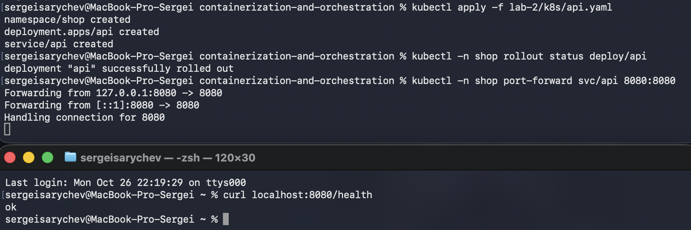

Также посмотрели логи — по ним всё тоже вайб:

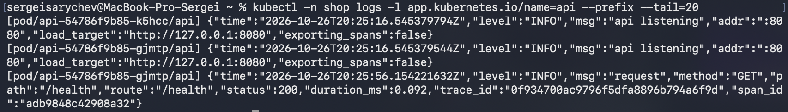

## Часть 1 — Метрики (Prometheus + Grafana)

Написали файлик [monitoring/kube-prometheus-stack.yaml](monitoring/kube-prometheus-stack.yaml), в нём:

- выключили четыре компонента control plane (они отдают метрики только внутри ноды и поэтому висели бы недоступными);
- забираем метрики раз в 15 секунд;
- показали, где брать метрики api (ServiceMonitor);
- добавили дашборд Grafana, чтобы всё отрисовывалось.

На дашборде четыре графика:

- Rate — запросы в секунду по ручкам;
- Errors — доля ответов 5xx;
- Duration — p95 времени ответа, общий и по каждой ручке;
- запросы в секунду по подам.

Подключили репозиторий с чартами и установили стек:


Пробросили порты и открыли Prometheus — у api 2/2 up, значит всё вайб:

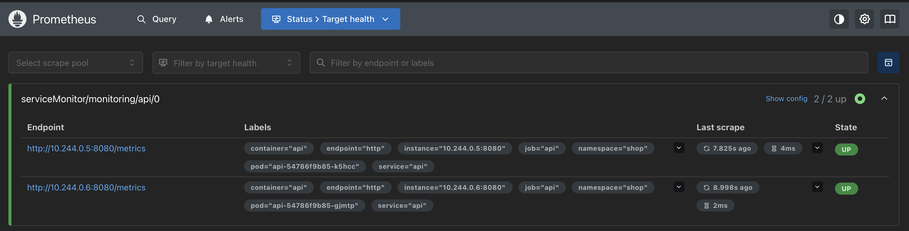

Посмотрели пароль для админки Grafana:

```bash
kubectl -n monitoring get secret monitoring-grafana -o jsonpath='{.data.admin-password}' | base64 -d; echo
```

И зашли в неё:

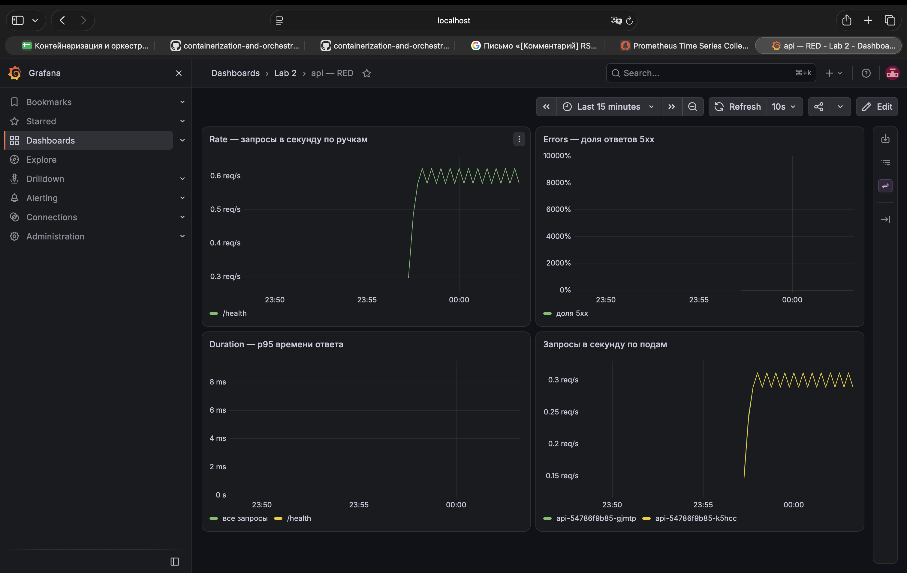

Выполняем следующую команду, нагружая сервис:

```bash
for i in {1..30}; do curl -s "localhost:8080/load?n=300" >/dev/null; sleep 2; done
```

И видим результат: нагрузка растёт только на один под (port-forward ведёт только в один под), `/health` значительно вырос, так как `/load` дёргает его много раз в секунду, p95 времени ответа для `/load` тоже увеличился:


Далее вводим команду:

```bash
for i in {1..60}; do curl -s localhost:8080/fail >/dev/null; sleep 1; done
```

И видим, как возрастает процент ответов с ошибками:

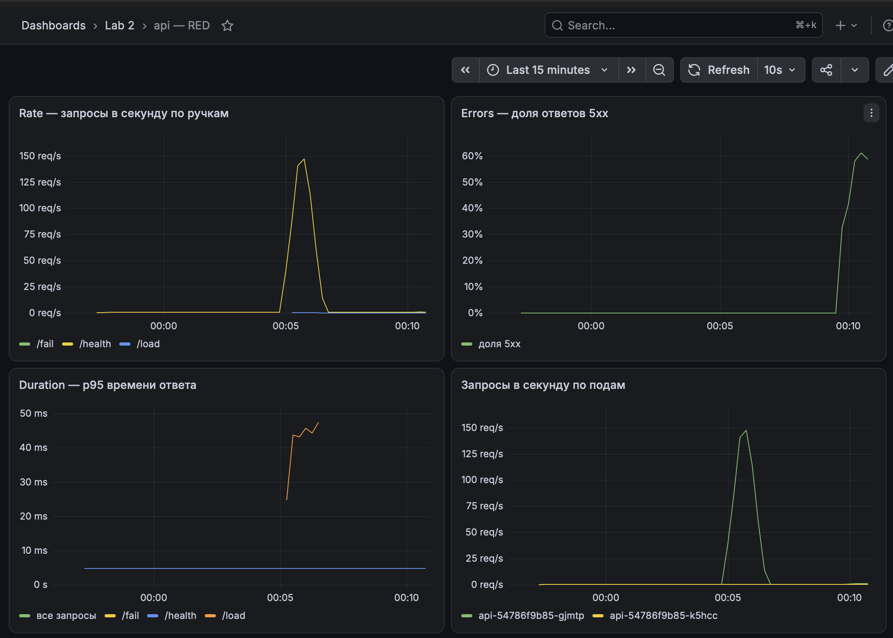

После — команда:

```bash
for i in {1..20}; do curl -s localhost:8080/slow >/dev/null; done
```

Видим, что p95 времени ответа для `/slow` — примерно 2.9 секунды:


## Часть 2 — Логи (Loki + Alloy)

Сам Loki логи не собирает, он их только хранит. Собирает агент Alloy, по одному на ноду он читает файлы логов контейнеров прямо на ноде и отправляет их в Loki (у него почемуто оранжевый значок - а не зеленый как по лору должен быть).

Написали два файлика и дополнили третий:

- [monitoring/loki.yaml](monitoring/loki.yaml) — Loki одним подом (SingleBinary), данные на диске ноды, без мультиарендности и лишних компонентов (шлюз, кеши, canary);
- [monitoring/alloy.yaml](monitoring/alloy.yaml) — Alloy находит поды своей ноды, читает их логи из `/var/log/pods`, снимает обёртку containerd, у api разбирает JSON (`level` — в метку, `trace_id` — в structured metadata) и отправляет в Loki;
- в [monitoring/kube-prometheus-stack.yaml](monitoring/kube-prometheus-stack.yaml) добавили Loki как источник данных Grafana и панель с логами ошибок на дашборд.

Подключили репозиторий с чартами Grafana:


Поставили Loki:


Поставили Alloy:

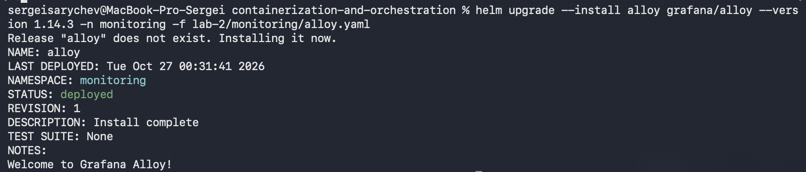

Все поды стека запущены, loki и alloy тоже:

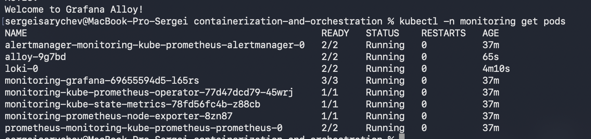

Заглянули в UI самого Alloy — там виден весь путь логов

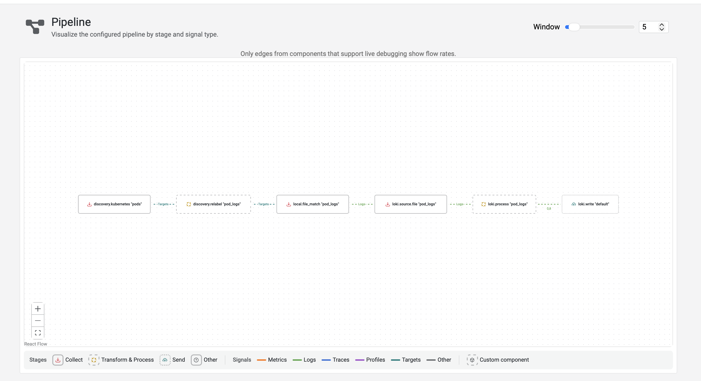

Обновили Grafana, чтобы подтянулись источник Loki и новая панель:

```bash
helm upgrade --install monitoring prometheus-community/kube-prometheus-stack --version 92.14.0 -n monitoring -f lab-2/monitoring/kube-prometheus-stack.yaml
```

Проверили источник данных — Grafana видит Loki, жесткий + вайб:


Насыпали ошибок:

```bash
for i in {1..20}; do curl -s localhost:8080/fail >/dev/null; sleep 1; done
```

И нашли их в Explore запросом:

```
{namespace="shop", app="api", level="ERROR"}
```

Строк 40 — на каждый `/fail` по две: `operation failed` с причиной `simulated failure` и строка самого запроса со статусом 500. У обеих один и тот же `trace_id`

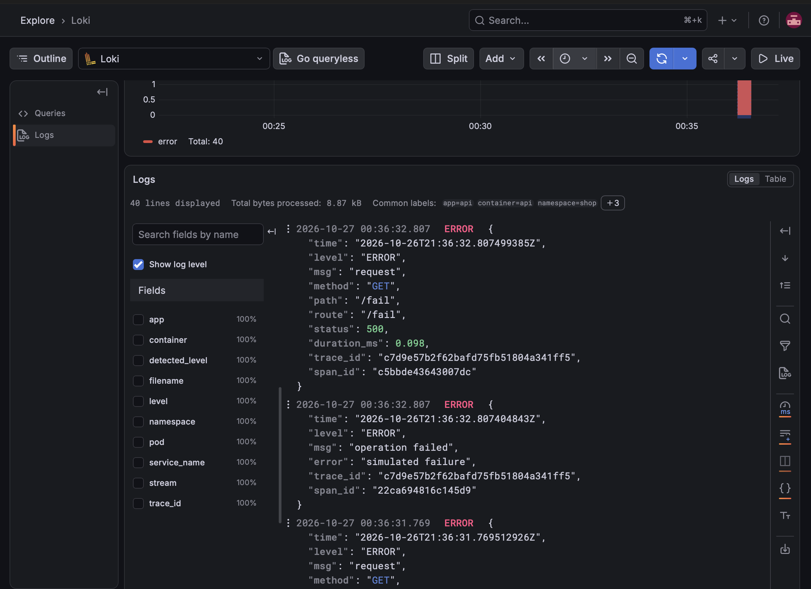

На дашборде теперь метрики и логи в одном месте: всплеск на графике ошибок и сами ошибки в панели логов внизу:


## Часть 3 — Трейсы (OpenTelemetry + Jaeger)

Сервис был инструментирован OpenTelemetry ещё в части 0: корневой span на каждый запрос создаёт otelhttp, в `/slow` есть вложенный `slow-op`, в `/fail` — `fail-op` со статусом ошибки, а `trace_id` пишется в каждую строку лога. Не хватало только места, куда отправлять span: без адреса сервис их создавал, но никуда не слал (`exporting_spans:false` в логах).

Что поменяли:

- [monitoring/jaeger.yaml](monitoring/jaeger.yaml) — Jaeger v2 одним подом (all-in-one): принимает трейсы по OTLP и хранит их в памяти; выключили только трейсинг самого Jaeger, чтобы в списке сервисов был один `api`;
- в [k8s/api.yaml](k8s/api.yaml) добавили переменную `OTEL_EXPORTER_OTLP_ENDPOINT=http://jaeger.monitoring.svc:4318` — адрес, куда SDK шлёт span;
- в [monitoring/kube-prometheus-stack.yaml](monitoring/kube-prometheus-stack.yaml) добавили Jaeger как источник данных Grafana, а у Loki — ссылки из строки лога в трейс по `trace_id`.

Подключили репозиторий и поставили Jaeger:

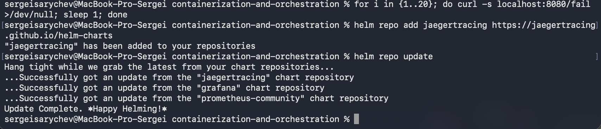


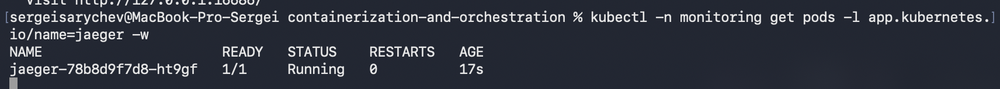

Применили обновлённый манифест api:

```bash
kubectl apply -f lab-2/k8s/api.yaml
```

Поды пересоздались, и теперь в логе старта `"exporting_spans":true` — span уходят в Jaeger, вайб:

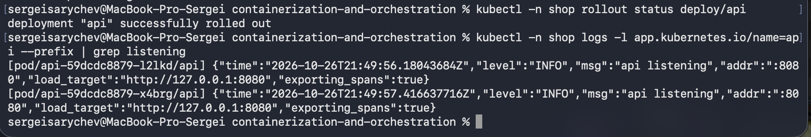

Обновили Grafana, чтобы подтянулись источник Jaeger и ссылки у Loki:


Подали запросы: пять `/slow`, пять `/fail` и один `/load` на 20 запросов:

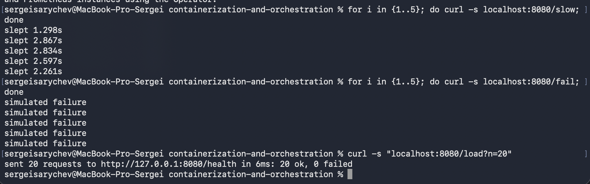

В Jaeger появился сервис `api` и 11 трейсов. У `/fail` по 2 span, и оба с ошибкой, у `/slow` по 2 span на 1–3 секунды, а у `/load` 41 span: сам `/load` и 20 пар «клиентский запрос → `/health`». То есть `trace_id` передаётся и между запросами:


Трейс `/slow`: почти все 2.3 секунды занимает вложенный `slow-op` (`sleep_ms = 2261`) — сразу видно, куда ушло время:

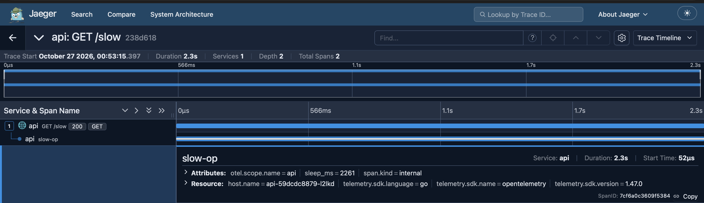

Трейс `/fail`: оба span красные — корневой с кодом 500 и `fail-op` с `otel.status_description = simulated failure` и событием `exception`:


И переход из лога в трейс. В Explore у строки лога с ошибкой появились ссылки по её `trace_id`:


«Трейс в Grafana» открывает трейс прямо в Grafana:


«Открыть в Jaeger UI» открывает тот же трейс в Jaeger — `trace_id` совпадает с тем, что в логе (`66e7be8…`):

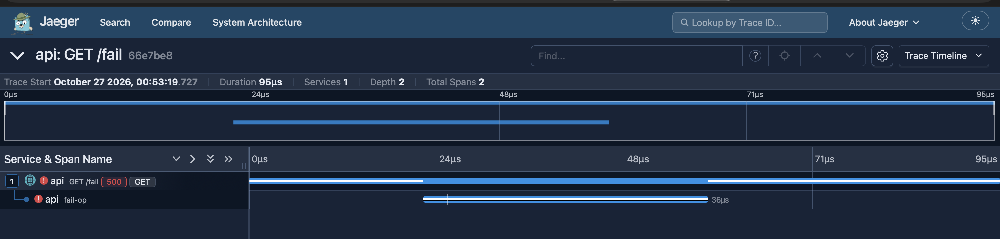