# Лаба 2 — Мониторинг всякого важного

## Часть 0 — свой сервис (сервис Клода)

С помощью клодик кода был сгенерирован сервис на Go, выполняющий все требования из лабы. Ручки:

- `GET /health`
- `GET /fail`
- `GET /slow`
- `GET /load`
- `GET /metrics`

Что сервис отдаёт:

**Метрики:**

- `http_requests_total{method,route,code}`;
- `http_request_errors_total{route}` — только 5xx;
- `http_request_duration_seconds{method,route,code}`;
- метрики рантайма `go_*` и процесса `process_*`.

**Логи:** JSON в stdout.

**Трейсы:** корневой span (`GET /slow` и т. п.) создаёт otelhttp, внутри — вложенные `slow-op` и `fail-op`. Отправка по OTLP/HTTP на адрес из `OTEL_EXPORTER_OTLP_ENDPOINT`.

Далее установили helm и kind на макбук (Pro M5 14", 16/512 GB).

После этого подняли кластер через kind и проверили, что с ним всё ок:


Вроде всё действительно ок (нода была NotReady, но через минуту стала Ready), но мне посоветовали обновить kubectl, так как он у меня отставал на 3 версии. Вроде и так нормик, но на всякий обновил.

После этого собрали образ и загрузили его в ноду:

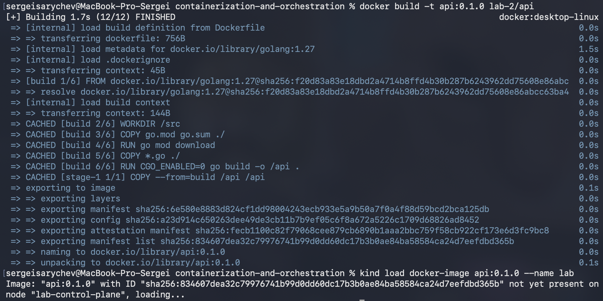

Он действительно подгрузился:


Написали манифест, в нём расписали, что делать, если под не готов или завис, и сколько ресурсов выделять. Он лежит в [k8s/api.yaml](k8s/api.yaml).

Применили манифест, перенаправили порты — и увидели, что `/health` отвечает на запросы, а значит вайбик:


Также посмотрели логи — по ним всё тоже вайб:


## Часть 1 — Метрики (Prometheus + Grafana)

Написали файлик [monitoring/kube-prometheus-stack.yaml](monitoring/kube-prometheus-stack.yaml), в нём:

- выключили четыре компонента control plane (они отдают метрики только внутри ноды и поэтому висели бы недоступными);
- забираем метрики раз в 15 секунд;
- показали, где брать метрики api (ServiceMonitor);
- добавили дашборд Grafana, чтобы всё отрисовывалось.

На дашборде четыре графика:

- Rate — запросы в секунду по ручкам;
- Errors — доля ответов 5xx;
- Duration — p95 времени ответа, общий и по каждой ручке;
- запросы в секунду по подам.

Подключили репозиторий с чартами и установили стек:

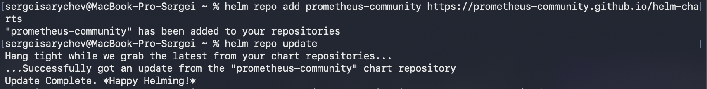

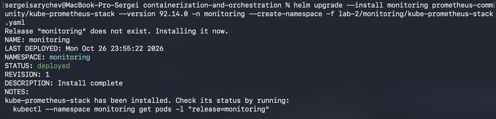

Пробросили порты и открыли Prometheus — у api 2/2 up, значит всё вайб:


Посмотрели пароль для админки Grafana:

```bash
kubectl -n monitoring get secret monitoring-grafana -o jsonpath='{.data.admin-password}' | base64 -d; echo
```

И зашли в неё:


Выполняем следующую команду, нагружая сервис:

```bash
for i in {1..30}; do curl -s "localhost:8080/load?n=300" >/dev/null; sleep 2; done
```

И видим результат: нагрузка растёт только на один под (port-forward ведёт только в один под), `/health` значительно вырос, так как `/load` дёргает его много раз в секунду, p95 времени ответа для `/load` тоже увеличился:

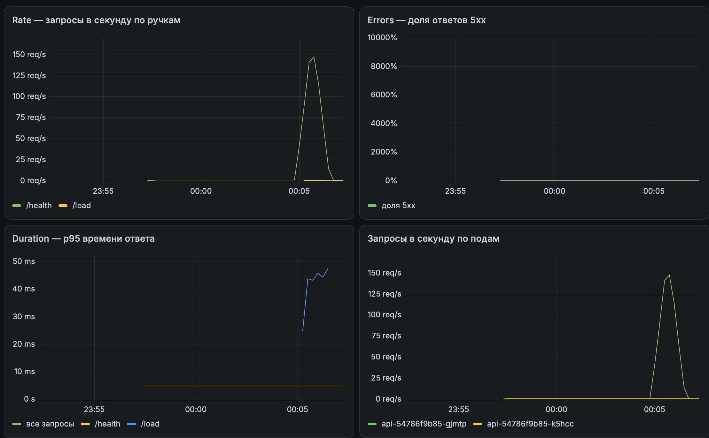

Далее вводим команду:

```bash
for i in {1..60}; do curl -s localhost:8080/fail >/dev/null; sleep 1; done
```

И видим, как возрастает процент ответов с ошибками:


После — команда:

```bash
for i in {1..20}; do curl -s localhost:8080/slow >/dev/null; done
```

Видим, что p95 времени ответа для `/slow` — примерно 2.9 секунды:

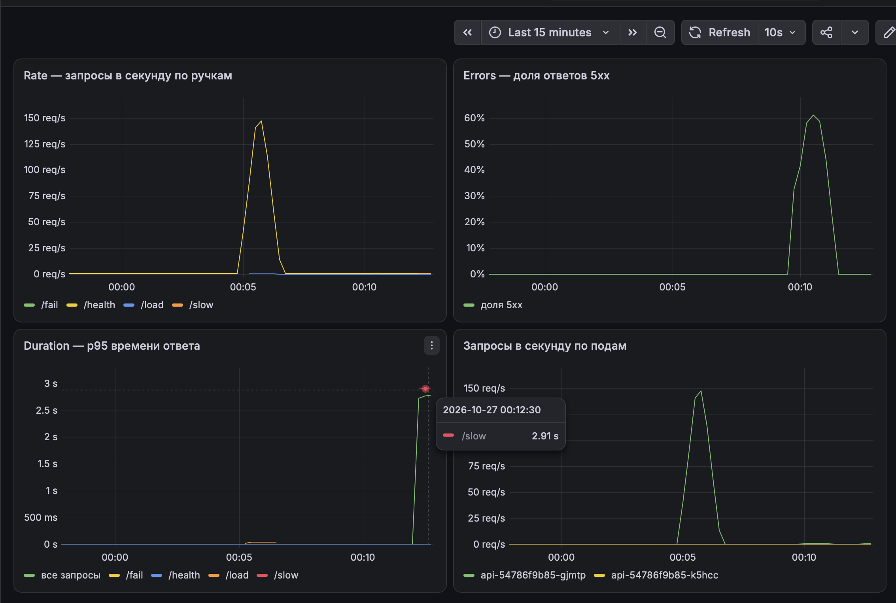

## Часть 2 — Логи (Loki + Alloy)

Сам Loki логи не собирает, он их только хранит. Собирает агент Alloy, по одному на ноду он читает файлы логов контейнеров прямо на ноде и отправляет их в Loki (у него почемуто оранжевый значок - а не зеленый как по лору должен быть).

Написали два файлика и дополнили третий:

- [monitoring/loki.yaml](monitoring/loki.yaml) — Loki одним подом (SingleBinary), данные на диске ноды, без мультиарендности и лишних компонентов (шлюз, кеши, canary);
- [monitoring/alloy.yaml](monitoring/alloy.yaml) — Alloy находит поды своей ноды, читает их логи из `/var/log/pods`, снимает обёртку containerd, у api разбирает JSON (`level` — в метку, `trace_id` — в structured metadata) и отправляет в Loki;
- в [monitoring/kube-prometheus-stack.yaml](monitoring/kube-prometheus-stack.yaml) добавили Loki как источник данных Grafana и панель с логами ошибок на дашборд.

Подключили репозиторий с чартами Grafana:

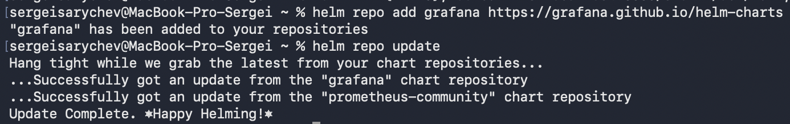

Поставили Loki:

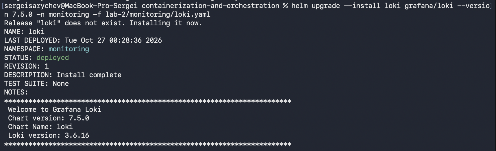

Поставили Alloy:


Все поды стека запущены, loki и alloy тоже:


Заглянули в UI самого Alloy — там виден весь путь логов


Обновили Grafana, чтобы подтянулись источник Loki и новая панель:

```bash
helm upgrade --install monitoring prometheus-community/kube-prometheus-stack --version 92.14.0 -n monitoring -f lab-2/monitoring/kube-prometheus-stack.yaml
```

Проверили источник данных — Grafana видит Loki, жесткий + вайб:

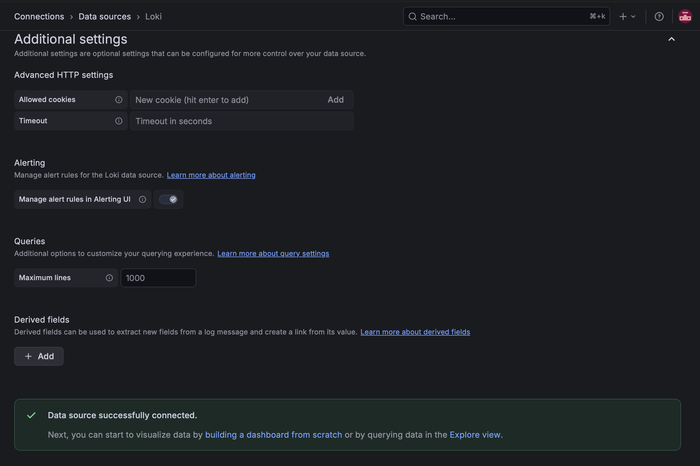

Насыпали ошибок:

```bash
for i in {1..20}; do curl -s localhost:8080/fail >/dev/null; sleep 1; done
```

И нашли их в Explore запросом:

```
{namespace="shop", app="api", level="ERROR"}
```

Строк 40 — на каждый `/fail` по две: `operation failed` с причиной `simulated failure` и строка самого запроса со статусом 500. У обеих один и тот же `trace_id`


На дашборде теперь метрики и логи в одном месте: всплеск на графике ошибок и сами ошибки в панели логов внизу:

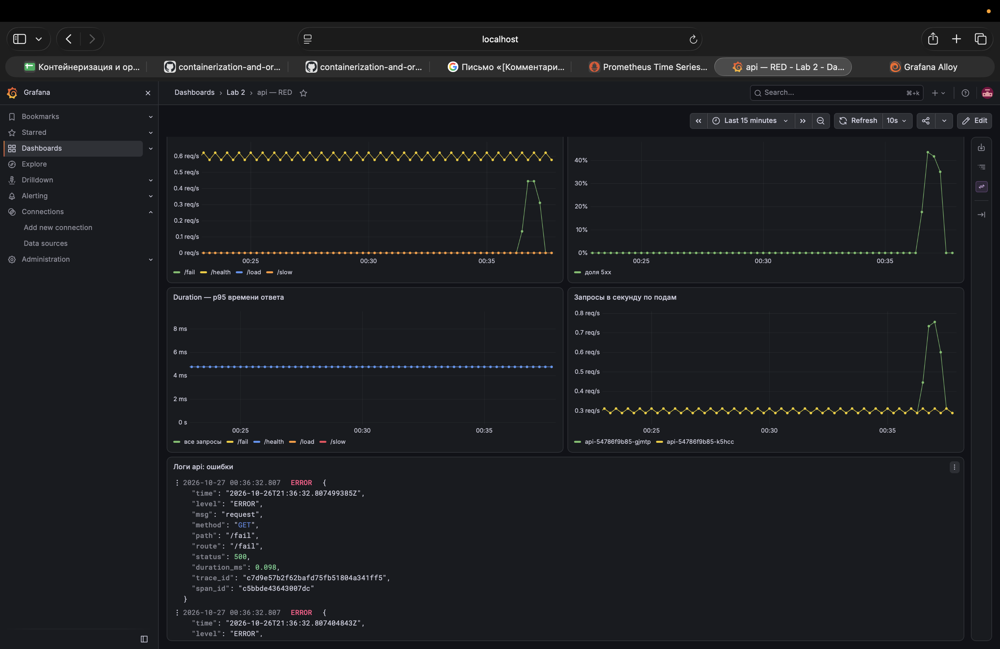

## Часть 3 — Трейсы (OpenTelemetry + Jaeger)

Сервис был инструментирован OpenTelemetry ещё в части 0: корневой span на каждый запрос создаёт otelhttp, в `/slow` есть вложенный `slow-op`, в `/fail` — `fail-op` со статусом ошибки, а `trace_id` пишется в каждую строку лога. Не хватало только места, куда отправлять span: без адреса сервис их создавал, но никуда не слал (`exporting_spans:false` в логах).

Что поменяли:

- [monitoring/jaeger.yaml](monitoring/jaeger.yaml) — Jaeger v2 одним подом (all-in-one): принимает трейсы по OTLP и хранит их в памяти; выключили только трейсинг самого Jaeger, чтобы в списке сервисов был один `api`;
- в [k8s/api.yaml](k8s/api.yaml) добавили переменную `OTEL_EXPORTER_OTLP_ENDPOINT=http://jaeger.monitoring.svc:4318` — адрес, куда SDK шлёт span;
- в [monitoring/kube-prometheus-stack.yaml](monitoring/kube-prometheus-stack.yaml) добавили Jaeger как источник данных Grafana, а у Loki — ссылки из строки лога в трейс по `trace_id`.

Подключили репозиторий и поставили Jaeger:


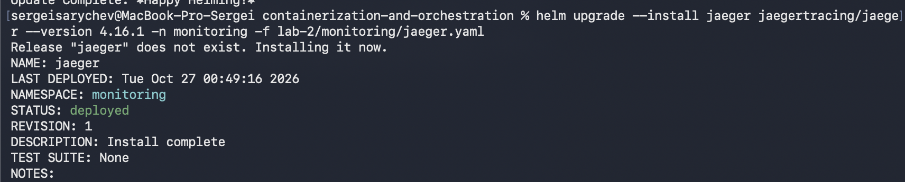


Применили обновлённый манифест api:

```bash
kubectl apply -f lab-2/k8s/api.yaml
```

Поды пересоздались, и теперь в логе старта `"exporting_spans":true` — span уходят в Jaeger, вайб:


Обновили Grafana, чтобы подтянулись источник Jaeger и ссылки у Loki:

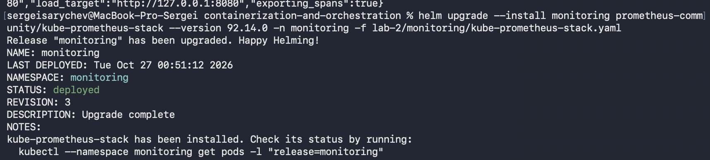

Подали запросы: пять `/slow`, пять `/fail` и один `/load` на 20 запросов:


В Jaeger появился сервис `api` и 11 трейсов. У `/fail` по 2 span, и оба с ошибкой, у `/slow` по 2 span на 1–3 секунды, а у `/load` 41 span: сам `/load` и 20 пар «клиентский запрос → `/health`». То есть `trace_id` передаётся и между запросами:

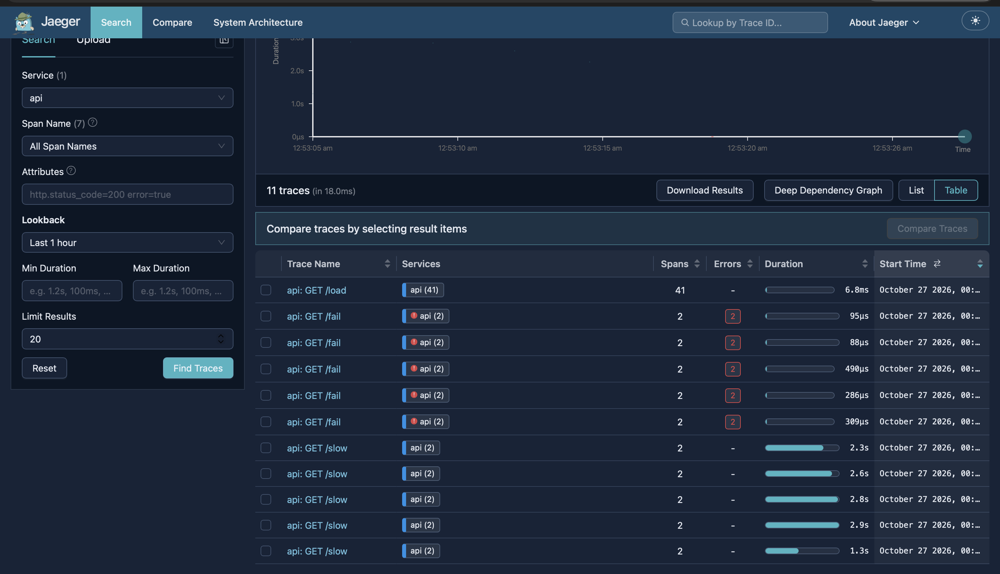

Трейс `/slow`: почти все 2.3 секунды занимает вложенный `slow-op` (`sleep_ms = 2261`) — сразу видно, куда ушло время:


Трейс `/fail`: оба span красные — корневой с кодом 500 и `fail-op` с `otel.status_description = simulated failure` и событием `exception`:

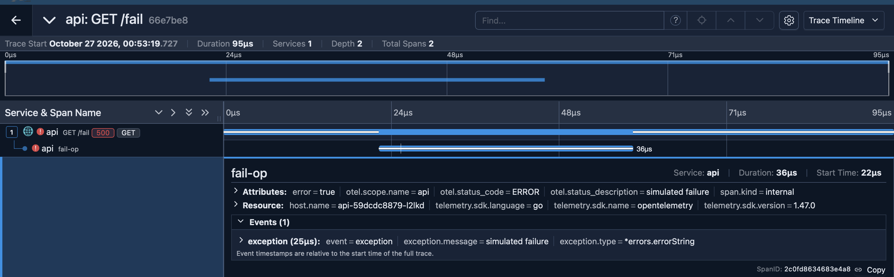

И переход из лога в трейс. В Explore у строки лога с ошибкой появились ссылки по её `trace_id`:

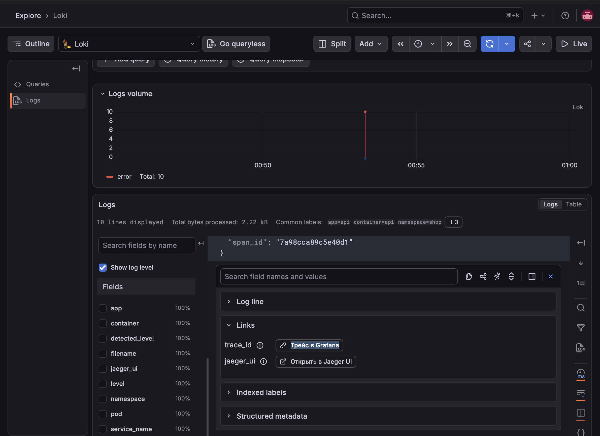

«Трейс в Grafana» открывает трейс прямо в Grafana:

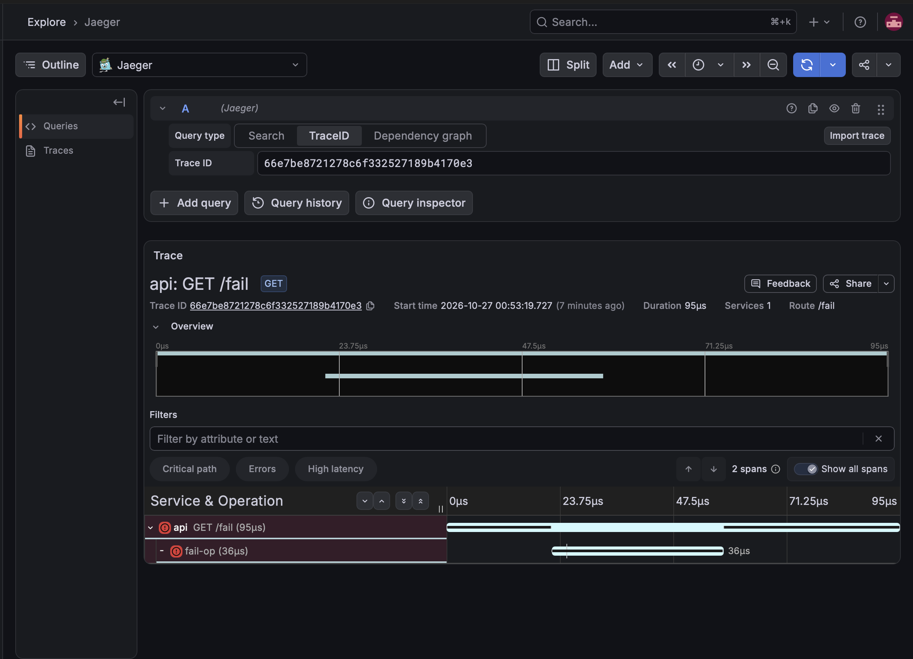

«Открыть в Jaeger UI» открывает тот же трейс в Jaeger — `trace_id` совпадает с тем, что в логе (`66e7be8…`):


## Часть 4 — Алерты (Alertmanager + Karma)
Prometheus раз в 30 секунд проверяет правила. Если условие выполнилось, алерт становится pending, а если продержалось дольше `for` — firing и уходит в Alertmanager. Alertmanager группирует алерты, решает, кому их отправить, и шлёт уведомление. Karma — дашборд поверх Alertmanager, где видны все активные алерты.

Что поменяли:

- в [monitoring/kube-prometheus-stack.yaml](monitoring/kube-prometheus-stack.yaml):
  - выключили стандартный `NodeClockNotSynchronising` — в kind он горит всегда, а сделать с ним ничего нельзя;
  - маршрут Alertmanager: все алерты уходят в получатель `webhook`, кроме `Watchdog` (он горит всегда и доказывает, что вся цепочка алертинга жива), группировка по `alertname` и `namespace`;
  - сам получатель — эхо-сервер, который пишет в лог каждое пришедшее уведомление, ставится этим же чартом;
- [monitoring/karma.yaml](monitoring/karma.yaml) — Karma с адресом Alertmanager.

### Три алерта

Все три — про то, что чувствуется пользователем и у него не работает.

**ApiHighErrorRate** — больше 5% ответов 5xx, держится 2 минуты:

```
sum(rate(http_request_errors_total{namespace="shop", job="api"}[5m]))
  / sum(rate(http_requests_total{namespace="shop", job="api"}[5m])) > 0.05
```

- пользователи получают ошибки;
- каждый 5xx — сорванный запрос пользователя, это очень чоень очень грустно и вообще беда;
- дежурный смотрит на дашборде посмотреть, какая ручка сыпет ошибками, в Loki можно найти строки `level=ERROR`, по ссылке открыть трейс и найти красный span; если перед этим был деплой —можно  откатить жеско.

**ApiHighLatency** — p95 времени ответа больше 1 секунды, держится 2 минуты:

```
histogram_quantile(0.95,
  sum by (le) (rate(http_request_duration_seconds_bucket{namespace="shop", job="api"}[5m]))) > 1
```

- сервис отвечает без ошибок, но медленно;
- для пользователя медленный сервис это ужас и бесит;
- увидев можно посмотреть p95 по ручкам на дашборде, в Jaeger отфильтровать трейсы по Min Duration и найти span, который съедает время, проверить, не упираются ли поды в ресурсы; масштабировать или откатить.

**ApiDown** — нет ни одного живого пода api, держится 1 минуту:

```
absent(up{namespace="shop", job="api"} == 1)
```

- сервис недоступен целиком;
- это худший случай и вообще очень плохо, и при этом первые два алерта молчат — без запросов нечего считать, поэтому для него нужно отдельное правило; падение одного пода из двух не критично, трафик уходит на второй;
- что делать при ошибки -  `kubectl get pods` и `kubectl describe pod` — смотреть на `OOMKilled`, `CrashLoopBackOff`, `ImagePullBackOff`, откатить последний деплой.

`for` нужен, чтобы короткий всплеск не дергал лишний раз. Окно `[5m]` сглаживает шум, но поэтому после окончания проблемы алерт ещё несколько минут остаётся firing.

### Проверка

Применили правила, маршрут Alertmanager и получатель:

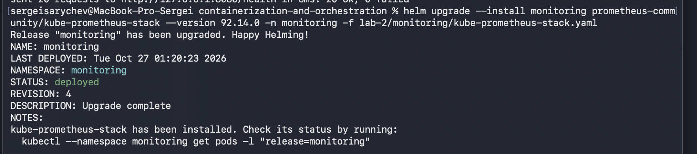

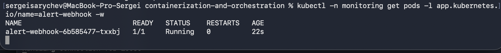

Поставили Karma:

```bash
helm repo add wiremind https://wiremind.github.io/wiremind-helm-charts
```

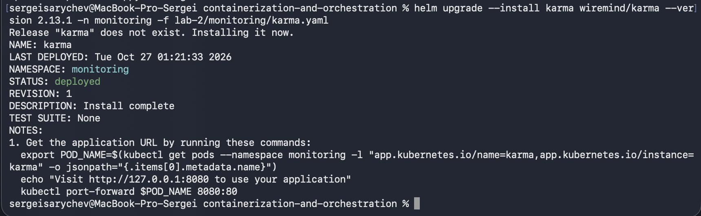

Правила загрузились, пока все зелёные:

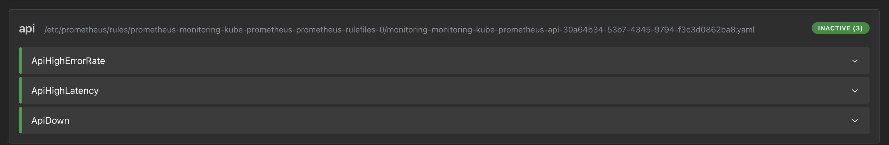

Одновременно запустили ошибки и медленные запросы:

```bash
for i in {1..60}; do curl -s localhost:8080/fail >/dev/null; sleep 1; done
```

```bash
for i in {1..30}; do curl -s localhost:8080/slow >/dev/null; done
```

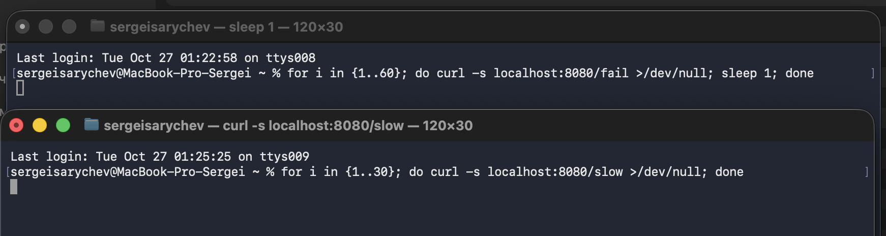

Сначала алерты pending — условие уже выполняется, но ещё не продержалось `for`, в Alertmanager они пока не уходят:

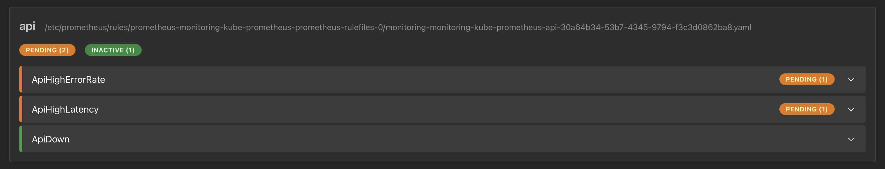

Через пару минут — firing:

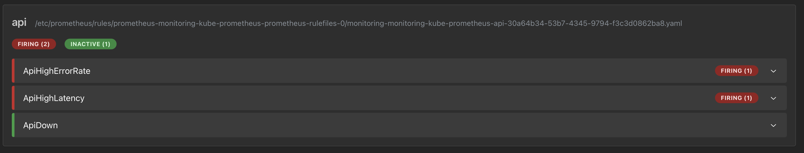

Потом положили сервис целиком:

```bash
kubectl -n shop scale deploy/api --replicas=0
```

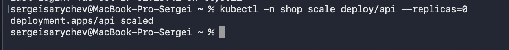

Через полторы минуты загорелся `ApiDown`, и все три алерта горят одновременно:

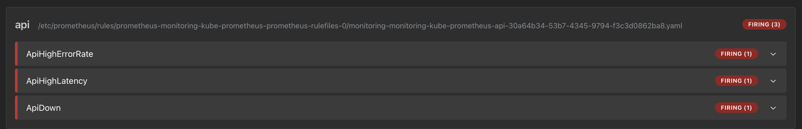

В Alertmanager видно маршрутизацию и группировку: наши алерты ушли в `webhook`, `Watchdog` — в `null`, каждая строка — группа по `alertname` и `namespace`:

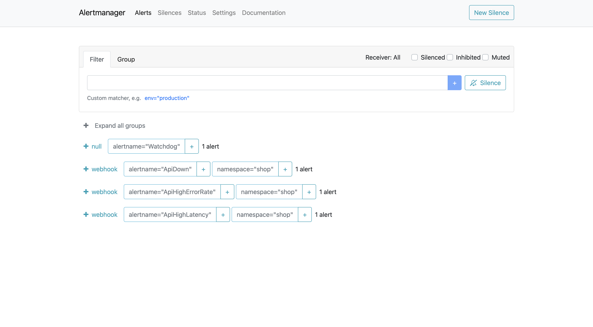

Те же алерты в Karma, с описаниями и подставленными значениями (например, p95 2.563s):

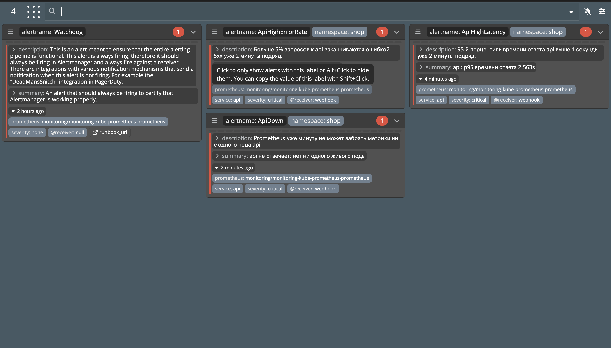

Получатель принял уведомления по всем трём. Первым пришёл `NodeClockNotSynchronising`: он горел ещё до перенастройки, и новый маршрут сразу применился к нему, а потом пришёл `resolved`, когда Prometheus перестал его присылать:

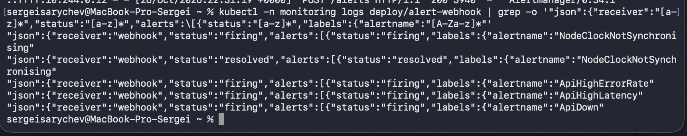

Вернули сервис:

```bash
kubectl -n shop scale deploy/api --replicas=2
```

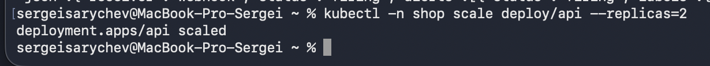

## Итог

Весь стек живёт в Kubernetes (kind) и поставлен через Helm — пять релизов с зафиксированными версиями и своими values в [monitoring/](monitoring/):

- `monitoring` (kube-prometheus-stack) — Prometheus, Grafana с RED-дашбордом и панелью логов ошибок, Alertmanager с тремя алертами и webhook-получателем;
- `loki` — хранилище логов;
- `alloy` — агент на каждой ноде, отправляет логи подов в Loki;
- `jaeger` — принимает трейсы по OTLP;
- `karma` — дашборд активных алертов.

Сервис api ([api/](api/)) отдаёт метрики на `/metrics`, пишет JSON-логи с `trace_id` и отправляет трейсы; в кластер он ставится манифестом [k8s/api.yaml](k8s/api.yaml). Всё связано: `/load`, `/fail` и `/slow` видны на дашборде, ошибки находятся в логах, из строки лога по `trace_id` открывается тот же трейс в Jaeger, а три алерта срабатывают и видны в Alertmanager и Karma.