# Лабораторная работа 3 - Платформа для shop

## Часть 0 - подготовка окружения и подопытного сервиса

### Окружение

Перед началом работы, пока клод создавал сервис, было установлено необходимое окружение

``` bash
brew install kind helm
```

Создан кластер из `kind.yaml` конфига

``` yaml
kind: Cluster
apiVersion: kind.x-k8s.io/v1alpha4
name: lab
nodes:
  - role: control-plane
    extraPortMappings:
      - containerPort: 30080
        hostPort: 30080
        protocol: TCP

```

`extraPortMappings` тут не просто так: порт 30080 мака пробрасывается на NodePort ноды. В части 4 мы будем гасить control plane, а `kubectl port-forward` ходит через apiserver и умрёт вместе с ним. NodePort обслуживает kube-proxy на самой ноде, так что через него можно будет проверить, что сервис жив и без apiserver.

``` bash
kind create cluster --config lab-3/kind.yaml
```

результат на скриншоте ниже


### Сервис

Сервис снова был создан клодом и снова на Go

- API:
    - **POST** `/order` Создает заказ
    - **GET** `/orders` выдает все заказы
    - **GET** `/version`
    - **GET** `/metrics`
    - **GET** `/health` (503, если `HEALTH_FAIL=true`, базу не трогает)

База через `DATABASE_URL`, без неё сервис стартует и живёт, это нужно, потому что Часть 2 идёт раньше Части 3

- Worker - раз в `POLL_INTERVAL` (5s) помечает пачку заказов `processed` через `FOR UPDATE SKIP LOCKED`, чтобы две реплики не хватали один заказ
 
    - `/health `
    - `/metrics` 
    - порт 8081

### Образы

Dockerfile у обоих сервисов одинаковый: multi-stage, сборка в `golang:1.27`, итоговый образ от `scratch` с одним бинарником и `USER 10001:10001`, версия зашивается через `--build-arg VERSION` и отдаётся в `/version`. Это пригодится в части 1 (правило про non-root) и в части 2 (видеть, какая версия отвечает во время rolling update).

Реестра у нас нет, образы грузятся в kind напрямую:

``` bash
docker build --build-arg VERSION=0.1.0 -t shop.local/api:0.1.0 lab-3/api
docker build --build-arg VERSION=0.1.0 -t shop.local/worker:0.1.0 lab-3/worker
kind load docker-image shop.local/api:0.1.0 shop.local/worker:0.1.0 --name lab
```

Префикс `shop.local/` это не реальный реестр: `kind load` кладёт образ в containerd ноды под полным именем, а `imagePullPolicy: IfNotPresent` находит его по имени и никуда не ходит. Зато в части 1 по этому префиксу правило про доверенный реестр будет отличать наши образы от чужих.


Проверка, что образы доехали до ноды:

``` bash
docker exec lab-control-plane crictl images | grep shop.local
```


## Часть 1 - что-то про политику и 5 кривых манифестов

### Выбор движка

Взяли Kyverno. Правила в нём это обычные Kubernetes-манифесты (`ClusterPolicy`), без отдельного языка, и на kind на ноутбуке он легче. Gatekeeper гибче, но учить Rego ради пяти правил смысла нет.

Ставится одним чартом, версию пинним, values свои и только с тем, что реально меняем: оставляем один admission controller, фоновое сканирование, отчёты и cleanup выключаем, в kind они просто едят память.

``` bash
helm upgrade --install kyverno kyverno/kyverno --version 3.9.2 -n kyverno --create-namespace -f lab-3/kyverno-values.yaml
kubectl -n kyverno get pods && kubectl get validatingwebhookconfigurations
```

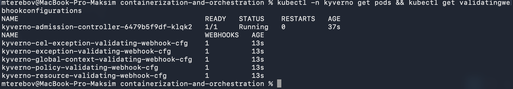

Список вебхуков и есть механизм: Kyverno регистрирует в apiserver validating webhook, и apiserver на каждый запрос синхронно спрашивает его до записи в etcd. Отбитый манифест до etcd не доезжает, kubectl получает отказ от apiserver с текстом из `message` правила.

Kyverno 1.19 при apply предупреждает, что `ClusterPolicy` deprecated и надо переезжать на CEL-политики (`ValidatingPolicy`). Работает всё по-прежнему, для лабы оставили старый формат, он читается без знания CEL.

### Что исключили

Правила cluster-wide, но из-под них явно выведены инфраструктурные namespace: `kube-system`, `kyverno`, `monitoring`, `cnpg-system`. Стек мониторинга из лабы 2 и оператор базы ставятся из чужих чартов, у половины их подов нет limits, а образы из `quay.io` и `ghcr.io`. Переписывать чужие values ради правил, которые мы придумали для своих сервисов, неправильно, поэтому правила защищают рабочие namespace, а инфра живёт по своим чартам. `kube-system` и `kyverno` Kyverno и так не трогает через `resourceFilters`, но в политиках они перечислены явно, чтобы бандл читался сам по себе.

### Пять правил

Все лежат в `lab-3/policies/`, у всех одна структура: `match` на `Pod`, `exclude` инфры, `validate` с `failureAction: Enforce` (Audit только записал бы в отчёт) и `pattern`. Правило написано для `Pod`, но Kyverno через autogen сам распространяет его на `Deployment`, `StatefulSet`, `Job` и остальные контроллеры, поэтому кривой `helm install` упадёт сразу на Deployment, а не потом на подах.

- `require-limits`: у каждого контейнера есть `resources.limits.cpu` и `memory`. Без лимитов один под может съесть всю ноду, с лимитами cgroup его режет (как в лабе 1), а scheduler знает, что куда влезает.
- `restrict-registry`: образы только `shop.local/*`. Образ из неизвестного реестра это чужой код в кластере. Правило закрывает все три списка контейнеров: `containers`, `initContainers` и `ephemeralContainers`, иначе обходится через init-контейнер или `kubectl debug`. В части 3 сюда добавится реестр оператора базы.
- `require-labels`: у пода обязателен `app.kubernetes.io/name`. По лейблам работают селекторы сервисов, `ServiceMonitor` и дашборды, под без лейбла для всего этого невидим.
- `disallow-privileged`: `securityContext.privileged` не может быть `true`. Privileged-контейнер это root на ноде со всеми устройствами, вся изоляция из лабы 1 выключается одним полем.
- `require-nonroot`, наше пятое: у пода обязателен `securityContext.runAsNonRoot: true`. Kubelet тогда перед стартом проверяет, под кем собирается работать образ, и не пускает uid 0. Поэтому в Dockerfile стоит именно числовой `USER 10001:10001`, по имени пользователя kubelet проверить не может.

``` bash
kubectl apply -f lab-3/policies/ && kubectl get clusterpolicy
```

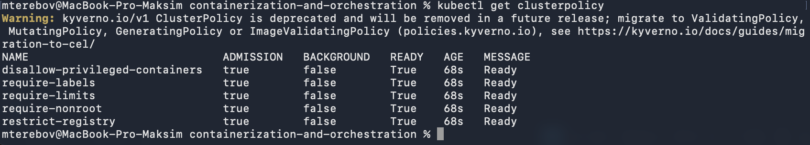

### Пять кривых подов

В `lab-3/policies/bad/` один правильный под, который проходит все пять правил, и пять копий, в каждой сломано ровно одно: `broken-limits` без `resources`, `broken-registry` с `nginx:1.27`, `broken-labels` без `labels`, `broken-privileged` с `privileged: true` у контейнера, `broken-nonroot` с `runAsNonRoot: false`. Ломать по одному важно, иначе непонятно, какое правило сработало.

``` bash
kubectl create ns shop
for f in lab-3/policies/bad/*.yaml; do echo "== $f"; kubectl apply -n shop -f "$f"; done
kubectl -n shop get pods
```

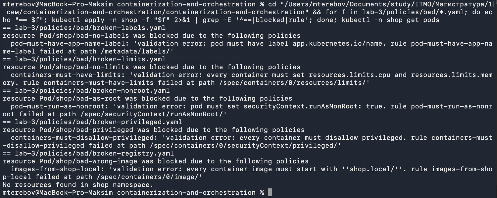

Все пять отбиты с текстом из `message`, в `shop` пусто: поды не создаются вообще, а не удаляются потом.

Попутно два манифеста с первого раза упали не на Kyverno: в одном имя пода было с заглавными буквами, в другом `privileged` лежал в `securityContext` пода, а такого поля там нет. Первый отбила встроенная валидация apiserver, второй не прошёл декодирование по схеме. Порядок в apiserver такой: декодирование → встроенная валидация → admission-вебхуки, и политики видят только то, что прошло первые два шага.

## Часть 2 - потрогать Helm-чарт

### Чарт

Helm коротко: чарт это папка с `Chart.yaml`, `values.yaml` и `templates/`, где лежат обычные манифесты с подстановками из values. Helm рендерит их и применяет, кластер видит только обычные объекты. Установленная копия это release, каждый `install`/`upgrade` даёт новую ревизию (хранится Secret-ом в namespace), поэтому есть `helm rollback`. Values накладываются слоями: дефолты чарта → `-f` файлы → `--set`.

Чарт лежит в `lab-3/shop/`: `Chart.yaml`, `values.yaml` и четыре шаблона, Deployment и Service для `api` и для `worker`. В values все ручки: образ и тег, replicas (3 для api и 2 для worker), `healthFail`, `resources`, nodePort для api. Правила из части 1 зашиты сразу: лейбл `app.kubernetes.io/name` в `template`, `resources.limits`, `runAsNonRoot: true`, образы `shop.local/*`. Пробы readiness и liveness обе на `/health`. Service у api типа NodePort 30080 (тот самый порт из `kind.yaml`), у worker обычный ClusterIP, он нужен не для трафика, а под `ServiceMonitor` в части 5.

Стратегия раскатки задана явно: `maxSurge: 1`, `maxUnavailable: 0`. Это и даёт «по одному»: сначала поднять один новый под, дождаться его readiness, потом убрать один старый.

Перед установкой чарт прогнали через `helm template ... | kubectl apply --dry-run=server`: server dry-run проходит через admission, то есть через Kyverno, и autogen проверяет Deployment как под. Поэтому сама установка прошла с первого раза без отказов по политикам, те же отказы мы видели в части 1 на кривых подах.

``` bash
helm upgrade --install shop lab-3/shop -n shop && kubectl -n shop get pods -w
```

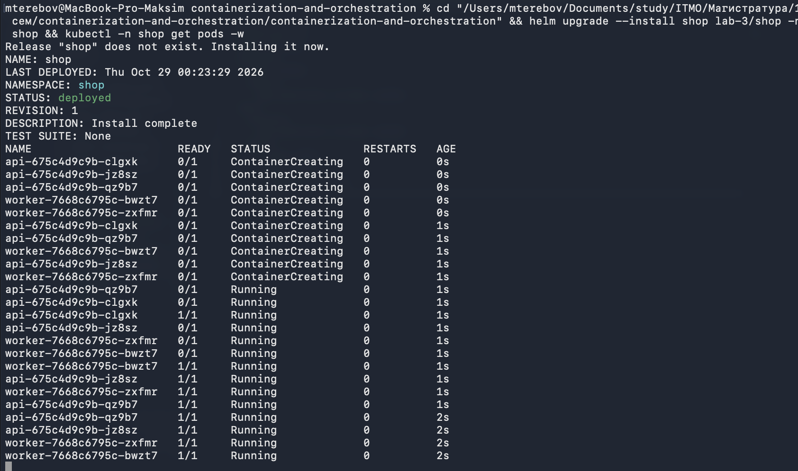

``` bash
curl -s localhost:30080/health; curl -s localhost:30080/version; kubectl -n shop get deploy,svc
```

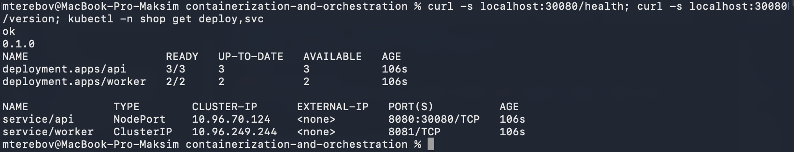

### Reconciliation

Удалили под api руками: через секунду на его месте новый, с другим суффиксом, у ReplicaSet `DESIRED 3 CURRENT 3`. Это не Helm и не мы, это ReplicaSet-контроллер увидел, что status разъехался со spec, и починил.

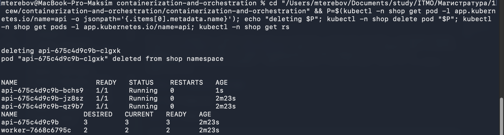

Поменяли в `values.yaml` `api.replicas: 4` и сделали `helm upgrade`: четвёртый под появился, `DESIRED 4`. Потом вернули 3 тем же способом.

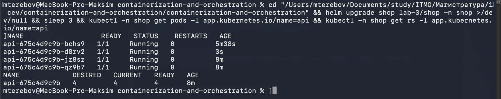

### Rolling update под нагрузкой

Собрали `shop.local/api:0.2.0` (версия зашивается в бинарник через `--build-arg VERSION`, её отдаёт `/version`) и загрузили в kind.

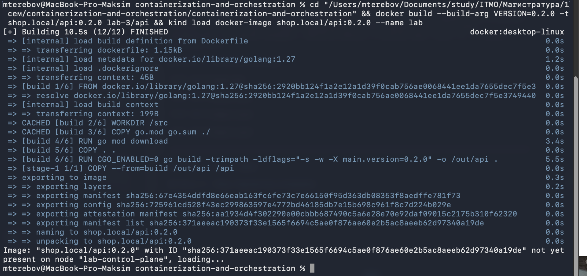

Дальше в фоне долбилка: `curl /health` через NodePort каждые 50 мс, печатает только не-200 и итог. На её фоне меняем `api.image.tag` на `0.2.0` и делаем `helm upgrade`. В `rollout status` видно, что поды меняются по одному: `1 out of 3`, `2 out of 3`, `1 old replicas are pending termination`. Старый ReplicaSet ушёл в 0, новый в 3, все три отвечают `0.2.0`.

Но долбилка поймала один `FAIL code=000` из 778, ровно в момент удаления последнего старого пода:

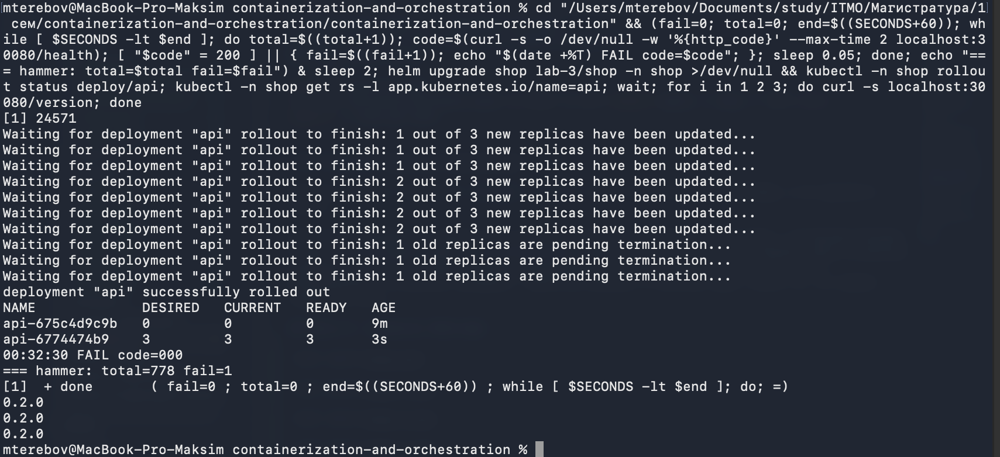

Это известная гонка. Когда под уходит в `Terminating`, параллельно происходят две независимые вещи: kubelet шлёт контейнеру SIGTERM, а endpoints-контроллер убирает под из Service и kube-proxy переписывает iptables на ноде. Наш api по SIGTERM сразу закрывает listener (честный graceful shutdown: дослужить начатое, новых не брать), а iptables ещё несколько десятков миллисекунд ведут на него. Новое соединение упирается в закрытый порт, отсюда `000`, connection refused.

Лечится `preStop`-хуком в Deployment api: под в `Terminating` ещё 5 секунд принимает трафик, за это время kube-proxy успевает выкинуть его из endpoints, и только потом приходит SIGTERM. Образ от `scratch`, бинарника `sleep` в нём нет, поэтому нативный `sleep`-хук Kubernetes, а не `exec`:

``` yaml
lifecycle:
  preStop:
    sleep:
      seconds: 5
```

Раскатали эту правку, собрали `0.3.0` и повторили тот же прогон: 792 запроса, `fail=0`, все три пода на `0.3.0`.

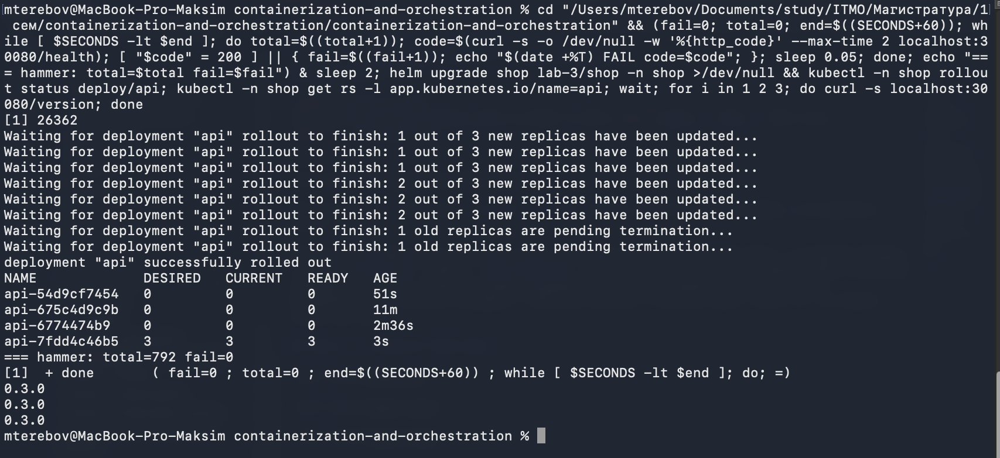

### Сломанная версия и rollback

`HEALTH_FAIL=true` передали через `--set api.healthFail=true`: это верхний слой values поверх файла, файл остаётся чистым, а ломать одноразово удобно. На фоне той же долбилки:

``` bash
helm upgrade shop lab-3/shop -n shop --set api.healthFail=true
```

Через 45 секунд картина: один новый под `0/1 Running` с рестартами (readiness не пускает его в Service, liveness на том же `/health` его перезапускает), три старых `1/1`, `/health` снаружи отдаёт `ok`, долбилка 796 запросов без единой ошибки. При этом Helm записал ревизию 9 как `deployed`: он только отправил объекты в apiserver, а раскатка это дело Deployment-контроллера, который из-за `maxUnavailable: 0` не трогает старые поды, пока новый не станет Ready. А он не станет никогда.

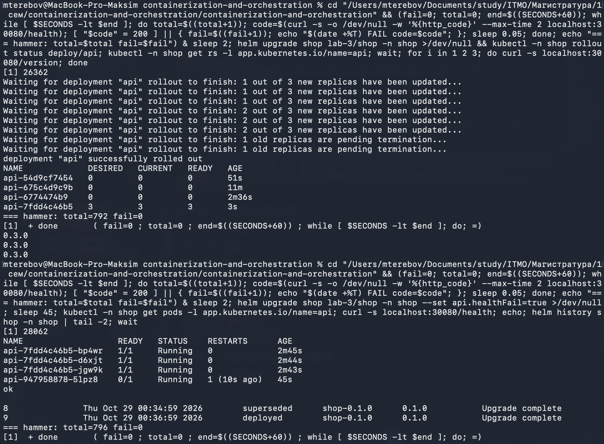

Откат на последнюю хорошую ревизию:

``` bash
helm rollback shop 8 -n shop
```

Сломанный под сразу в `Terminating`, три старых как были, `ok`, в истории ревизия 10 с описанием `Rollback to 8`. Rollback это не «отменить», а новая ревизия со старым манифестом, поэтому история только растёт. И откатывает он кластер, а не файл: если бы мы ломали правкой `values.yaml`, следующий `upgrade` сломал бы всё снова, с `--set` этой проблемы нет.

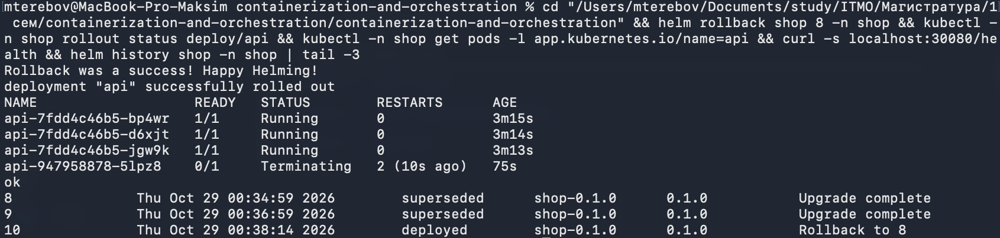

## Часть 3 - Слон в ящике

### Оператор

Из двух операторов взяли CloudNativePG: у него один понятный объект `Cluster`, он активно живёт, и namespace `cnpg-system` мы уже заранее вынесли из-под политик. Оператор ставится один раз на весь кластер, values ему не нужны, дефолты не трогали, только пин версии:

``` bash
helm upgrade --install cnpg cnpg/cloudnative-pg --version 0.29.1 -n cnpg-system --create-namespace
kubectl get crd | grep cnpg
```

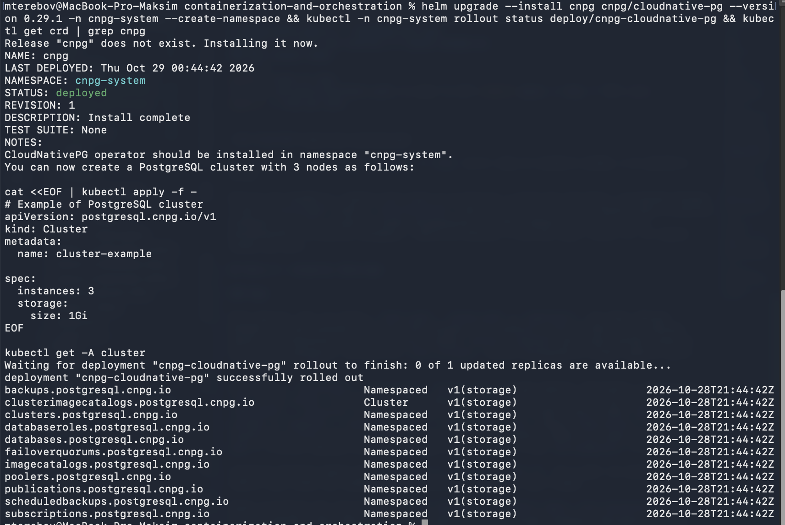

Список CRD это первая половина оператора: `Cluster`, `Backup`, `Pooler` и остальные стали обычными типами объектов в apiserver, их можно `kubectl get`, они лежат в etcd. Вторая половина это контроллер в `cnpg-system`, который за этими объектами следит.

### База в чарте

В чарт добавлен `templates/postgres-cluster.yaml`: одна нода postgres (kind на ноутбуке, реплики не нужны), том 1Gi, `resources` под `require-limits` и `inheritedMetadata.labels`, чтобы оператор навесил наш `app.kubernetes.io/name` на всё, что создаёт. Мы описываем только spec, а поды, PVC, сервисы `shop-db-rw`/`-ro`/`-r` и секрет `shop-db-app` делает оператор. В секрете есть ключ `uri` с готовой строкой подключения, его и отдаём `api` и `worker` в `DATABASE_URL` через `secretKeyRef`.

После `helm upgrade` `api` и `worker` перекатились и сразу поднялись (секрет оператор создаёт раньше самой базы, а наши сервисы без базы живут), а вот `Cluster` завис в `Setting up primary`. В логах оператора причина: Kyverno отбил Job `shop-db-1-initdb`, у его init-контейнера образ `ghcr.io/cloudnative-pg/...`. Autogen сработал на `Job`, а не только на `Pod`.

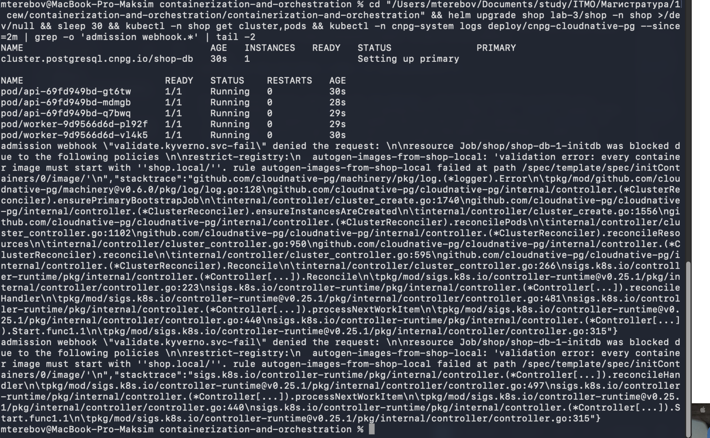

Это ровно тот случай, ради которого правило про реестр закрывает init-контейнеры. Починили правило: `image: "shop.local/* | ghcr.io/cloudnative-pg/*"`.

Дальше вылез второй слой. Оператор после отказа ушёл в backoff и не повторял попытку, пришлось подтолкнуть его аннотацией на `Cluster`. Job создался, но его под завис в `Pending`: PVC не провижнился. В событиях PVC:

```
failed to provision volume with StorageClass "standard": ... admission webhook "validate.kyverno.svc-fail" denied the request:
resource Pod/local-path-storage/helper-pod-create-pvc-... was blocked due to the following policies
require-labels: ... require-limits: ...
```

Провиженер `local-path` в kind на каждый том создаёт вспомогательный под в своём namespace `local-path-storage`, и его тоже поймали наши правила. Добавили `local-path-storage` в исключения всех пяти политик, PVC сразу стал `Bound`, initdb отработал, поднялся `shop-db-1`.

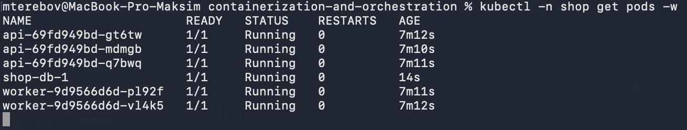

Вывод: cluster-wide правила ловят всё, включая поды, которые создаёт не человек, а оператор или провиженер. Список исключений это не костыль, а явное решение, кому правила не адресованы.

### Заказы через базу

``` bash
curl -s -X POST localhost:30080/order -d '{"item":"book","qty":2}'
curl -s -X POST localhost:30080/order
sleep 7; curl -s localhost:30080/orders
```

Два заказа создались со `status: new`, через семь секунд worker их забрал (`orders processed, ids [1,2]` в логах), в `/orders` они уже `processed`, кластер `Cluster in healthy state`.

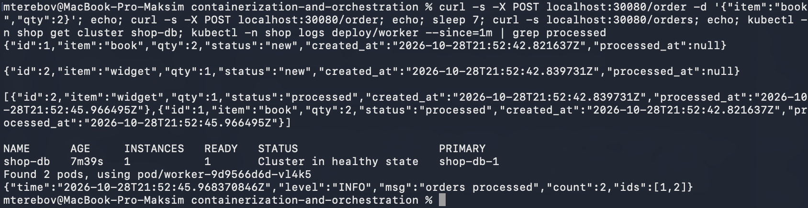

### Reconciliation на операторе

Удалили под базы руками: `kubectl -n shop delete pod shop-db-1`. Оператор вернул его, и тут видна разница с Deployment: под вернулся с тем же именем `shop-db-1`, а не с новым случайным суффиксом, и с тем же томом. Инстансы postgres не взаимозаменяемы, поэтому оператор думает в терминах «инстанс 1 и его PVC», а не «любые N подов». Заказы в `/orders` пережили удаление, данные были на томе, а не в поде.

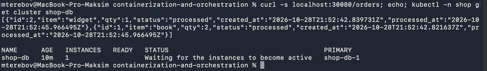

В объекте есть `spec` и `status`, строки 17 и 102 в YAML. Скрин снят в момент, когда оператор ещё чинил: в spec `instances: 1`, в status `phase: Waiting for the instances to become active`, `readyInstances` пустой, primary `shop-db-1`, PVC `shop-db-1` здоров. Это и есть reconcile-цикл вживую: spec говорит, как должно быть, status, как есть сейчас, контроллер закрывает разницу.

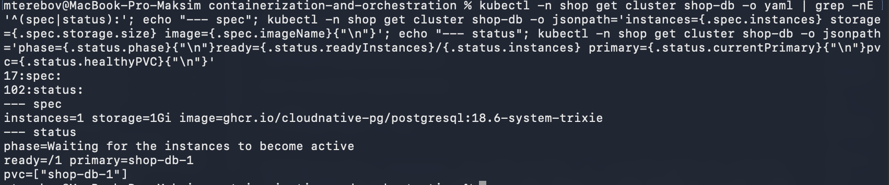

Через минуту всё сошлось:

```
NAME      AGE   INSTANCES   READY   STATUS                     PRIMARY
shop-db   13m   1           1       Cluster in healthy state   shop-db-1
NAME        READY   STATUS    RESTARTS   AGE
shop-db-1   1/1     Running   0          57s
NAME        STATUS   VOLUME                                     CAPACITY   ACCESS MODES   STORAGECLASS
shop-db-1   Bound    pvc-bba814b8-0c1b-4e8e-ac12-2cd042e48094   1Gi        RWO            standard
```

### Чем оператор отличается от controller-manager

Оба крутят один и тот же бесконечный reconcile-цикл: смотрят spec, сравнивают со status, чинят разницу. Разница в том, что они умеют чинить. Controller-manager это набор встроенных контроллеров для встроенных типов (Deployment, ReplicaSet, Job), и логика у них универсальная: должно быть N одинаковых подов, любой можно убить и заменить любым. Оператор это такой же контроллер, но для своего типа (`Cluster`) и со знанием предметной области: поды postgres не взаимозаменяемы, есть primary и реплики, перед стартом нужен `initdb`, том надо вернуть именно тому же инстансу, при смерти primary сделать failover. Это та часть, которую controller-manager про базу знать не может. Оператор это CRD плюс контроллер с доменной логикой, а не «разворачиватель».

## Часть 4 - Chaos Engineering эксперимент

## Часть 5 - Мониторинг
