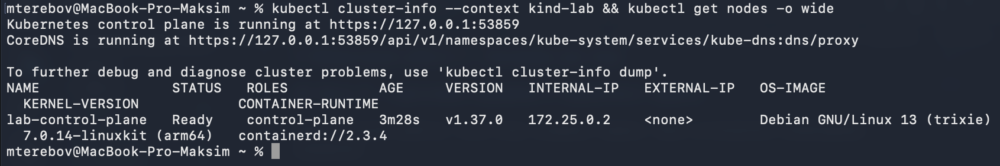
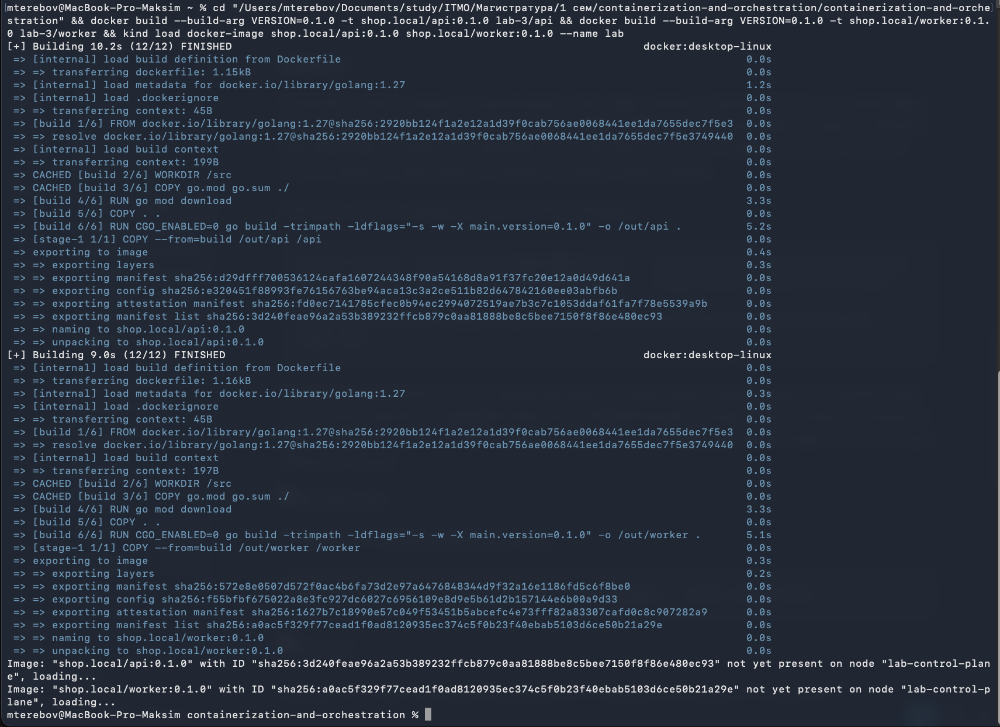
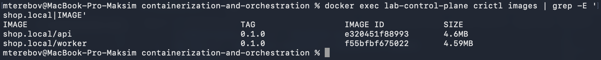

# Лабораторная работа 3 - Платформа для shop

## Часть 0 - подготовка окружения и подопытного сервиса

### Окружение

Перед началом работы, пока клод создавал сервис, было установлено необходимое окружение

``` bash
brew install kind helm
```

Создан кластер из `kind.yaml` конфига

``` yaml
kind: Cluster
apiVersion: kind.x-k8s.io/v1alpha4
name: lab
nodes:
  - role: control-plane
    extraPortMappings:
      - containerPort: 30080
        hostPort: 30080
        protocol: TCP

```

`extraPortMappings` тут не просто так: порт 30080 мака пробрасывается на NodePort ноды. В части 4 мы будем гасить control plane, а `kubectl port-forward` ходит через apiserver и умрёт вместе с ним. NodePort обслуживает kube-proxy на самой ноде, так что через него можно будет проверить, что сервис жив и без apiserver.

``` bash
kind create cluster --config lab-3/kind.yaml
```

результат на скриншоте ниже



### Сервис

Сервис снова был создан клодом и снова на Go

- API:
    - **POST** `/order` Создает заказ
    - **GET** `/orders` выдает все заказы
    - **GET** `/version`
    - **GET** `/metrics`
    - **GET** `/health` (503, если `HEALTH_FAIL=true`, базу не трогает)

База через `DATABASE_URL`, без неё сервис стартует и живёт, это нужно, потому что Часть 2 идёт раньше Части 3

- Worker - раз в `POLL_INTERVAL` (5s) помечает пачку заказов `processed` через `FOR UPDATE SKIP LOCKED`, чтобы две реплики не хватали один заказ
 
    - `/health `
    - `/metrics` 
    - порт 8081

### Образы

Dockerfile у обоих сервисов одинаковый: multi-stage, сборка в `golang:1.27`, итоговый образ от `scratch` с одним бинарником и `USER 10001:10001`, версия зашивается через `--build-arg VERSION` и отдаётся в `/version`. Это пригодится в части 1 (правило про non-root) и в части 2 (видеть, какая версия отвечает во время rolling update).

Реестра у нас нет, образы грузятся в kind напрямую:

``` bash
docker build --build-arg VERSION=0.1.0 -t shop.local/api:0.1.0 lab-3/api
docker build --build-arg VERSION=0.1.0 -t shop.local/worker:0.1.0 lab-3/worker
kind load docker-image shop.local/api:0.1.0 shop.local/worker:0.1.0 --name lab
```

Префикс `shop.local/` это не реальный реестр: `kind load` кладёт образ в containerd ноды под полным именем, а `imagePullPolicy: IfNotPresent` находит его по имени и никуда не ходит. Зато в части 1 по этому префиксу правило про доверенный реестр будет отличать наши образы от чужих.



Проверка, что образы доехали до ноды:

``` bash
docker exec lab-control-plane crictl images | grep shop.local
```



## Часть 1 - что-то про политику и 5 кривых манифестов

## Часть 2 - потрогать Helm-чарт 

## Часть 3 - Слон в ящике

## Часть 4 - Chaos Engineering эксперимент

## Часть 5 - Мониторинг
