# Лаба 4 — SLA критического пути под перегрузкой


Лаба про то, что делает планировщик, когда ресурсов не хватает, и как устроить так, чтобы под перегрузкой страдала фоновая аналитика `batch`, а оформление заказа (`api → postgres`) продолжало работать. Всё настраивается через чарт `shop` из лабы 3, руками только смотрим и даём нагрузку.

## Часть 0 — Сервис batch

Клодиком был написан сервис на Go, который ничего полезного не делает, а просто всё время жрёт CPU и память.
Как он грузит:

- **CPU:** `CPU_WORKERS` горутин по кругу считают SHA-256, каждая забирает до целого ядра;
- **память:** держит `MEMORY_MB` мегабайт и пишет в каждую страницу, чтобы память реально была занята в RAM, а не только «выделена». Набирает её не сразу, а по `MEMORY_STEP_MB` в секунду

Ещё есть `/health` для проб и `/metrics`. Метрика `batch_work_total` считает сделанную работу

Образ собирается так же, как `api` и `worker` в лабе 3
Собрали образ и запустили контейнер с лимитами: пол-ядра, 256 МБ памяти, держать 128 МБ:

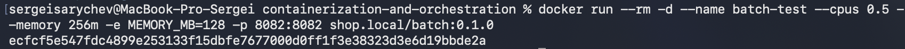

В итоге CPU ровно около 50%: воркер хочет целое ядро, но `--cpus 0.5` его режет. Памяти 133 МБ из 256: заказанные 128 МБ плюс сам процесс. По метрикам вся память набрана и работа идёт:

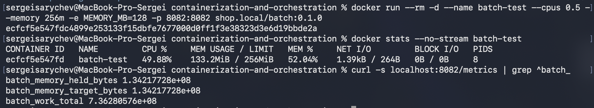

## Часть 1 — Механизм разнесения


Чарт `shop` из лабы 3 скопировали в [shop/](shop/values.yaml)

В `values.yaml` у `api` появился блок `spread`, где выбирается механизм:

```yaml
spread:
  mechanism: topologySpreadConstraints   # или podAntiAffinity
  topologyKey: kubernetes.io/hostname    # разносим по нодам
  maxSkew: 1
  hard: true
```

Шаблон `shop.spread` в [_helpers.tpl](shop/templates/_helpers.tpl) смотрит на `mechanism` и вставляет в под либо `topologySpreadConstraints`, либо `podAntiAffinity`. Если там опечатка, `helm` сразу падает с понятной ошибкой. Реплик у `api` теперь две, по одной на ноду.

Кластер для проверки не нужен: `helm template` рендерит чарт локально. Выбранный вариант:

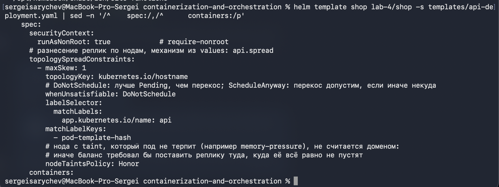

И anti-affinity:

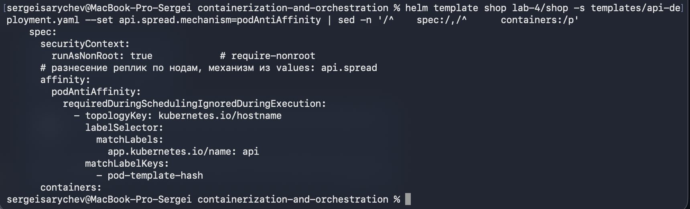

### Чем они отличаются

- **podAntiAffinity** — правило «попарно не рядом»: под не ставят на ноду, где уже есть под с той же меткой. Жёсткий вариант (`required`) — не больше одной реплики на ноду, поэтому на наших двух нодах третья реплика навсегда застрянет в `Pending`. Мягкий (`preferred`) — только подсказка: если места мало, планировщик спокойно сложит все реплики на одну ноду.
- **topologySpreadConstraints** — правило про баланс: на разных нодах число подов отличается не больше чем на `maxSkew`. С `maxSkew: 1` две реплики встают 1+1, три — 2+1, четыре — 2+2. Разнесение гарантировано, но потолка на число реплик нет.

У обоих механизмов жёсткий вариант работает на этапе фильтрации (нода не подходит — под ждёт), а мягкий на этапе оценки нод и просто влияет на выбор.

### Почему topologySpreadConstraints

Нод у нас две, и хочется, чтобы на каждой гарантированно была реплика `api`, но без потолка «реплик не больше, чем нод». А лишние реплики будут точно: при каждой раскатке (`maxSurge: 1`) на время поднимается третий под, а далее будем добавлять реплики, чтобы поймать preemption.

Ещё два поля в шаблоне:

- `matchLabelKeys: [pod-template-hash]` — при раскатке считаются только поды новой версии. Без этого anti-affinity не дал бы новому поду встать вообще (обе ноды заняты старыми), и раскатка зависла бы, а topologySpreadConstraints мог бы положить обе новые реплики на одну ноду.
- `nodeTaintsPolicy: Honor` — нода с taint, который под не терпит, не участвует в подсчёте баланса. Иначе правило требовало бы поставить реплику туда, куда её всё равно не пустят.

## Часть 2 — Тесная площадка

### Кластер

Кластер из лабы 2 снесли и подняли новый из [kind.yaml](kind.yaml): две ноды, control plane и worker.

С control plane сняли taint (`taints: []`), иначе обычным подам осталась бы одна нода и разносить `api` было бы некуда.

 Обе kind-ноды это контейнеры в одной VM Docker Desktop, и каждая считает своей всю VM: 10 CPU и 7.75 ГБ. Поэтому уменьшали их через kubelet:

```yaml
kind: KubeletConfiguration
systemReserved:            
  cpu: 8500m
  memory: 4608Mi
evictionHard:
  memory.available: 512Mi  
```

Подам на каждой ноде остаётся allocatable = capacity − systemReserved − evictionHard: **1.5 CPU и 2.75 ГБ**. Именно эти числа видит планировщик.

С `evictionHard` вылезла неочевидная штука: kind по умолчанию переопределяет его одними дисковыми порогами, и порога по памяти нет вообще. То есть kubelet в kind никогда не выселяет поды из-за нехватки памяти, ноду спасает только OOM-killer ядра. Порог вернули.

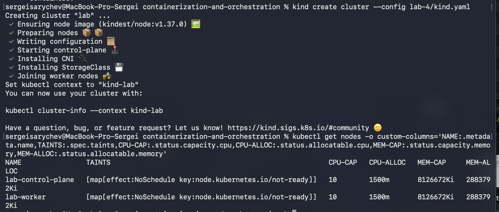

В колонках `CAP` вся VM, в `ALLOC` наши 1500m и ~2.75 ГБ. Taint `not-ready` на скрине временный: ноды ещё не успели стать Ready (сеть поднимается), через пару секунд он исчезает. Taint control plane там нет.

### Платформа из лабы 3

Ставили то же, что в лабе 3, с теми же версиями и values: Kyverno с пятью правилами, оператор CloudNativePG и стек мониторинга. Порядок важен:

- сначала Kyverno и правила, чтобы `shop` уже встречала проверка;
- потом оператор базы: без него apiserver не знает тип `Cluster` из чарта;
- потом мониторинг: без его CRD чарт не создаст ServiceMonitor и PrometheusRule.

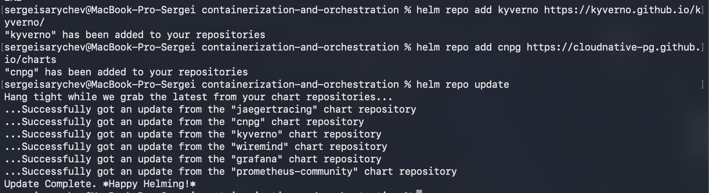

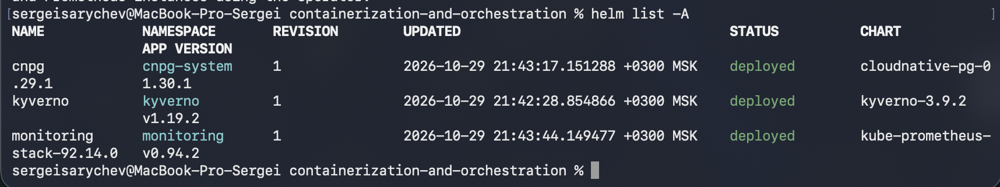

### batch в чарте

В чарт добавили [batch-deployment.yaml](shop/templates/batch-deployment.yaml) и Service к нему (трафика у batch нет, Service нужен, чтобы Prometheus собирал его метрики). В `values.yaml` новый блок `batch`: 2 реплики, requests 250m / 128Mi, limits 500m / 512Mi. Под обычный, правила лабы 3 действуют: лейбл, limits, non-root, образ `shop.local/`.

Образы `api` и `worker` собрали из кода в `lab-3/`, `batch` из части 0, и загрузили на обе ноды:

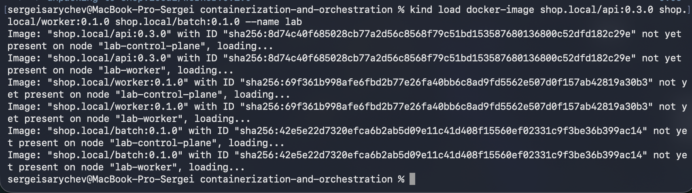

Поставили чарт:

```bash
helm upgrade --install shop lab-4/shop -n shop --create-namespace --reset-values
```

`--reset-values` пишем всегда: Максим в лабе 3 наступил на то, что без него Helm подтягивает values из прошлого релиза, и однажды заданный `--set` прилипает.

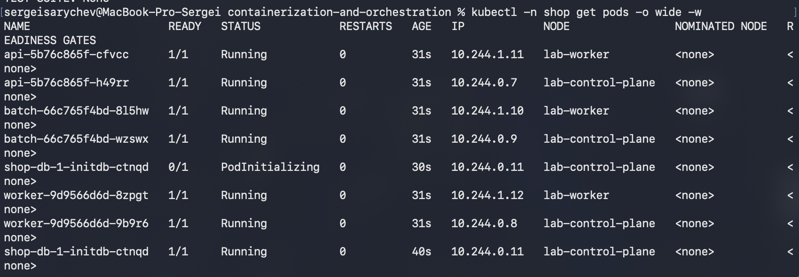

Через минуту всё `Running`. Kyverno пустил `batch` с первого раза, а реплики `api` уже стоят на разных нодах, разнесение из части 1 работает:

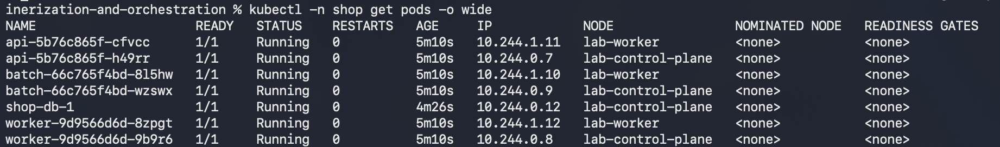

### Проверка

Заказ через NodePort создаётся, а по `Allocated resources` видно, насколько тесно: на control plane уже зарезервировано 1400m из 1500m CPU (93%), большую часть съели его собственные поды (apiserver, etcd, coredns). На worker пока 550m (36%).

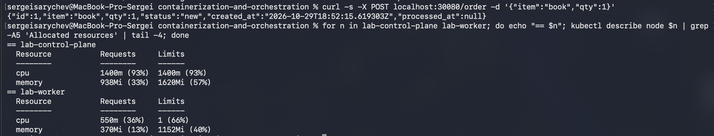

## Часть 3 — Реальные числа вместо угадывания

В лабе 3 requests и limits угадывали на глаз. Теперь дали на путь заказа ровную нагрузку, Prometheus её записал, и числа посчитал `krr`.

### Нагрузка

Скрипт для k6 [load/order.js](load/order.js): 50 заказов в секунду на `POST /order` в течение 15 минут. Исполнитель `constant-arrival-rate` шлёт запросы по часам и не ждёт ответов, как настоящие покупатели. Если сервис начнёт тормозить, это будет видно в задержках, а не спрячется за тем, что клиент сам притормозил.

Итог: 45001 заказ, ни одной ошибки, p95 меньше миллисекунды. Для сервиса такая нагрузка почти ничего не стоит:

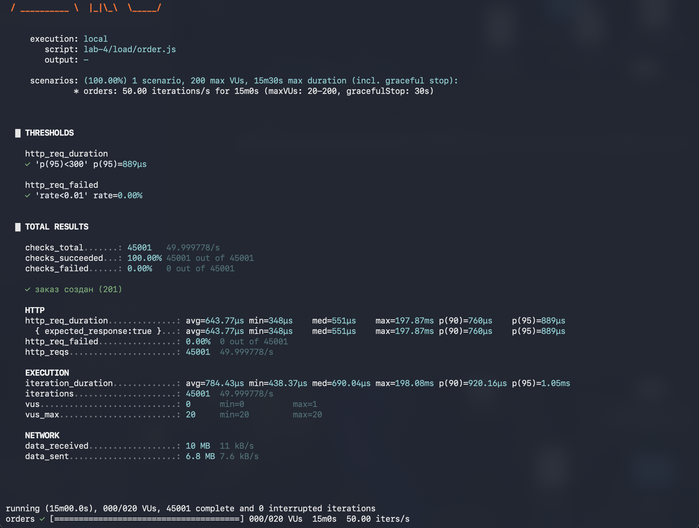

### krr

```bash
krr simple -n shop -p http://localhost:9090 --history_duration 1 --timeframe_duration 1 --points_required 20
```

`krr` берёт из Prometheus реальное потребление контейнеров и считает просто: CPU request = 95-й перцентиль, CPU limit не ставит, память = максимум + 15% и в request, и в limit. По умолчанию он смотрит две недели истории и хочет 100 точек на сервис, а нашему кластеру всего час, поэтому окно 1 час с шагом в минуту и 20 точек.

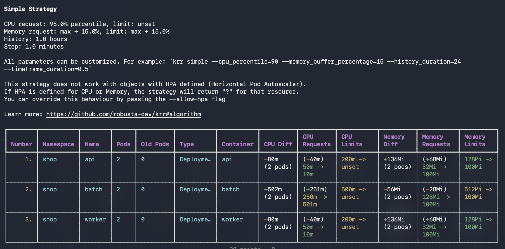

Отчёт сохранили в [krr/krr-report.csv](krr/krr-report.csv).

### Postgres руками

Postgres в отчёте нет. `krr` ищет поды через Deployment, StatefulSet, Job и подобные, а поды CloudNativePG принадлежат кастомному объекту `Cluster`, про который `krr` ничего не знает. Поэтому посчитали его же формулой прямо в Prometheus. CPU, 95-й перцентиль: 0.0094 ядра = 9.4m:

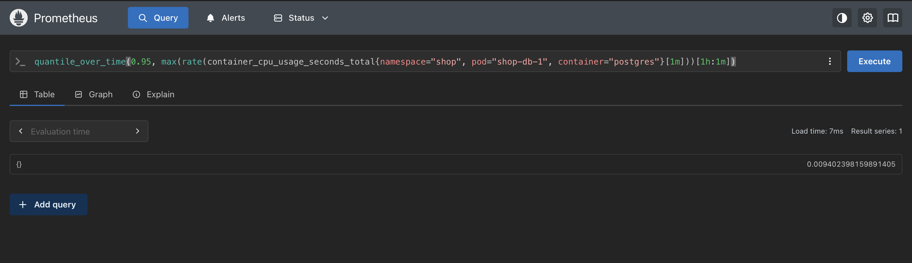

Память, максимум + 15%: 97 МБ:

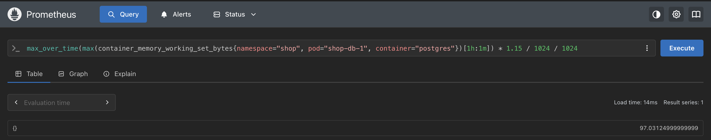

### Что взяли

| | догадка из лабы 3 (requests → limits) | krr | взяли |
|---|---|---|---|
| `api` | 50m / 32Mi → 200m / 128Mi | 10m / 100Mi, CPU limit не ставить | 10m / 100Mi → 200m / 100Mi |
| `worker` | 50m / 32Mi → 200m / 128Mi | 10m / 100Mi, CPU limit не ставить | 10m / 100Mi → 200m / 100Mi |
| postgres | 100m / 256Mi → 500m / 512Mi | формула krr: 10m / 100Mi | 10m / 256Mi → 500m / 256Mi |

Вписали в `values.yaml` и выкатили через `helm upgrade`:

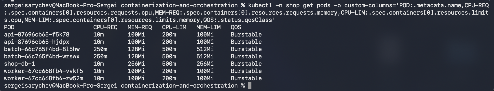

### Откуда разрыв

- **CPU угадали в разы больше.** Под нагрузкой `api` тратит 4–6m, `worker` меньше 1m, Postgres 9m. Сервис на Go и один INSERT на заказ почти ничего не стоят, 50 заказов в секунду для них мелочь. В лабе 3 числа брали без измерений.
- **Память угадали меньше, чем советует krr, но больше реальной.** `api` и `worker` реально держат ~10 МБ, а `krr` советует 100Mi. Это не измерение, а его минимум: меньше 100Mi памяти и 10m CPU он не советует, чтобы не было впритык. Так что для `api` и `worker` в таблице по сути его минимумы.
- **CPU limit krr советует не ставить:** limit означает throttling, под тормозит даже на свободной ноде. Но правило `require-limits` из лабы 3 требует limit, поэтому оставили прежний. В части 5 у `api` и Postgres limit станет равен request.
- **Память Postgres взяли 256Mi вместо 97Mi.** У Postgres `shared_buffers` = 128 МБ, это кеш таблиц, он заполняется по мере роста данных. Таблица заказов сейчас всего 3.8 МБ, поэтому за час `krr` и увидел ~80 МБ. С limit 100Mi база рано или поздно упала бы с `OOMKilled`, когда кеш наполнится: `krr` видит прошлое, а не конфиг.
- **batch krr советует 501m, ровно его limit.** `krr` видит только то, что под успел потребить, а `batch` хочет целое ядро и упирается в limit 500m. Спрос выше limit'а `krr` не видит в принципе. `batch` не трогаем, он нарочно остаётся жертвой с маленькими requests.
- **Час истории и один профиль нагрузки** для учебного кластера нормально, но в проде `krr` смотрят на недели, чтобы в окно попали пики.

